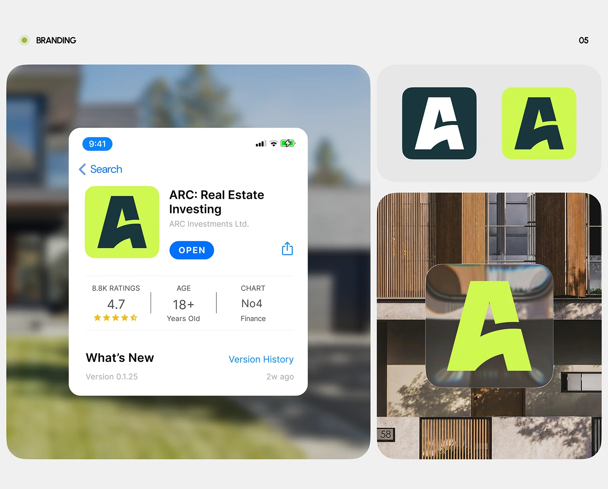

# Slashed-A monogram as app icon in dark green and lime with store listing and glass tile

**Discipline:** branding · **Design type:** Brand application mockups
**Tags:** app-icon, monogram, lime, dark-green, store-listing, glass, real-estate, architecture

## What it is
A grey board with three rounded panels: a blurred house background with a white App Store-style page for 'ARC: Real Estate Investing', a pair of icons (white A on dark green, dark A on lime), and a lime A on a refractive glass tile over a timber-slatted facade.

## What it means
Fresh and confident; lime on dark green is instantly recognisable and the glass tile feels premium.

## Techniques
- Show the icon in dark and lime versions side by side.
- Place the mark on a refractive glass tile over real architecture.
- Present a realistic store listing to prove the icon in context.
- Blur the background to keep focus on the UI card.

## Best for
- Proptech and fintech identity boards
- App icon presentations
- Neon-accent brands

## Vocabulary
- **Refractive glass tile** — A translucent tile that bends and tints the scene behind it.
- **Icon pair** — Two colour variants of the same icon.
- **Store listing mockup** — A facsimile of an app store page.
- **Blurred context** — An out-of-focus photo behind a UI card.
