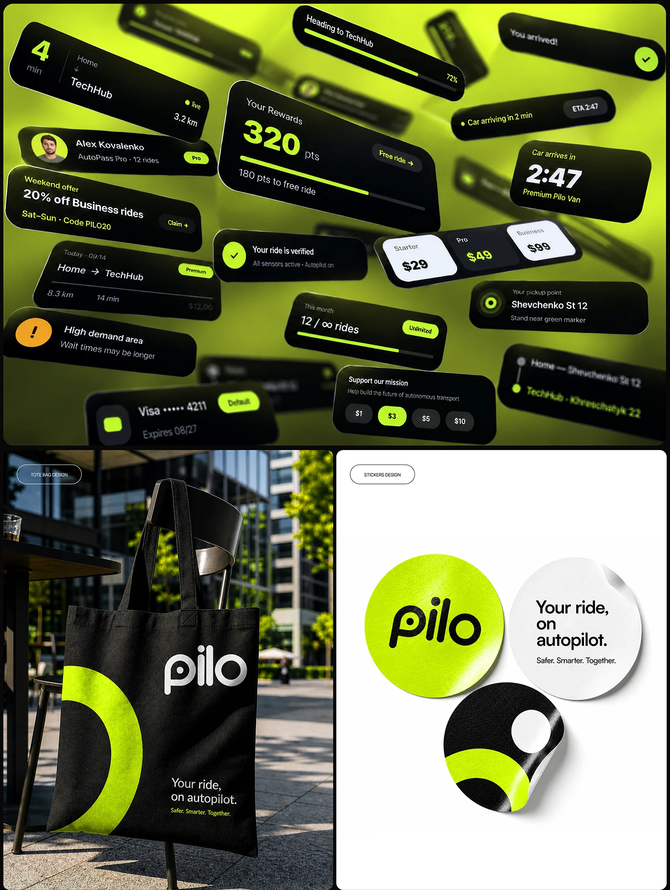

# Floating black UI cards on lime, a black tote with lime arc and round stickers

**Discipline:** branding ·  · **Design style:** Playful & Illustrated
**Tags:** lime, black, ui-cards, tote, stickers, 3d-perspective, mobility, merch

## What it is
A board with a lime-to-olive blurred field of tilted black notification cards (rewards, ETA, pricing, payment), beneath which a black tote with a huge lime arc and white wordmark hangs on a chair, and lime, white and black round stickers with the logo and slogan.

## What it means
Energetic and cohesive; one lime-black system runs from UI to merch.

## Techniques
- Float UI cards in 3D perspective as a pattern.
- Reuse the logo arc as a graphic on merch.
- Make round stickers in three colourways.
- Photograph merch in real settings.

## Best for
- Mobility and tech brand systems
- UI-as-pattern showcases
- Merch presentations

## Vocabulary
- **UI confetti** — Interface cards scattered as decoration.
- **Logo arc** — A cropped part of the logo used as graphic.
- **Die-cut sticker** — A sticker cut to a round shape.
- **Merch photography** — Products shown in a lifestyle scene.
