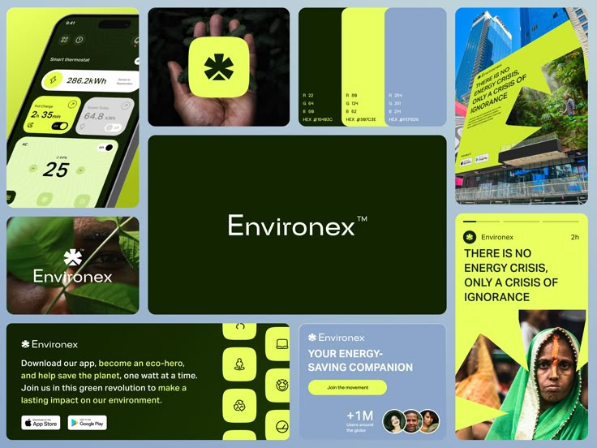

# Lime and Forest Green Eco Brand Board

**Discipline:** branding ·  · **Design style:** Geometric & Bauhaus
**Tags:** eco, lime, forest-green, asterisk, billboard, story, palette, bento

## What it is
A bento board with a lime-edged phone showing an energy dashboard, a hand holding a lime asterisk app icon, colour cards with RGB and hex, a dark wordmark tile, a tilted billboard on a tower, a leaf photo with the logo, a download banner with lime icon tiles and an Instagram story.

## What it means
Lime and forest green feel natural and energetic, and the bold asterisk mark works at every scale.

## Techniques
- Asterisk mark on a lime rounded square
- Dark green wordmark tile as the anchor
- Angled billboard with a lime speech-shape
- Photography of leaves and people in the brand tones
- Story format with bold headline on lime

## Best for
- Sustainability and energy brands
- Bento identity boards
- Apps with a bold single-symbol logo

## Vocabulary
- **Symbol tile** — A rounded square holding the brand mark.
- **Colour spec card** — A swatch listing RGB and hex values.
- **Speech-shape frame** — A pointed shape framing text like a speech bubble.
