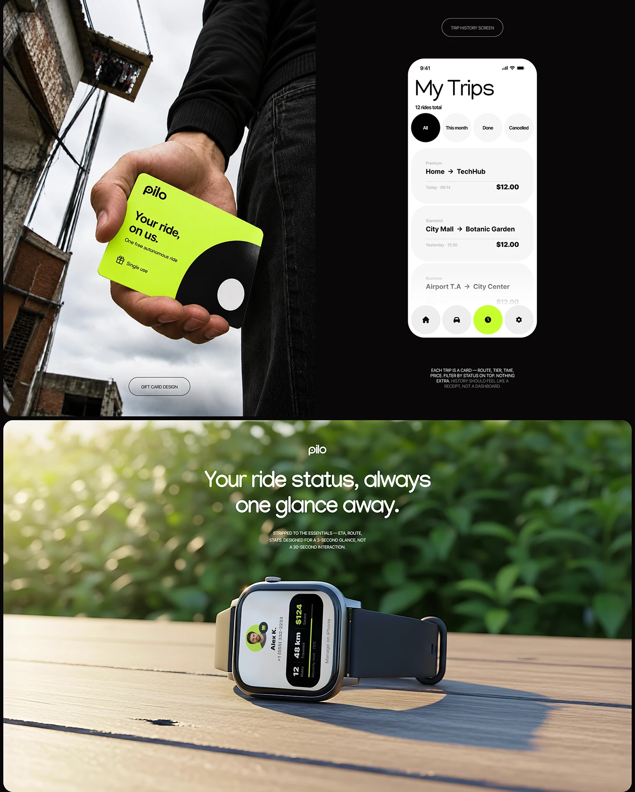

# Lime gift card in hand, black trip-history screen and a smartwatch on a wooden ledge with foliage

**Discipline:** branding · **Design type:** Brand application mockups
**Tags:** gift-card, mobility, lime, black, smartwatch, photography, app-screen, application

## What it is
A board with a low-angle photo of a hand holding a lime card with a black arc and slogan against a decaying building, a black panel with a white 'My Trips' screen with round filter chips and trip cards, and a green-bokeh photo of a smartwatch on wood with a glanceable ride status.

## What it means
Confident and versatile; lime and black run from print to wearable.

## Techniques
- Shoot a gift card in a gritty setting for contrast.
- Use big round filter chips in the app.
- Show a watch UI in natural light.
- Repeat the arc graphic across surfaces.

## Best for
- Mobility brand rollouts
- Gift card and wearable presentations
- Multi-channel brand boards

## Vocabulary
- **Glance UI** — A very small screen for quick reading.
- **Gift card design** — A branded card with a promise of value.
- **Round filter** — A circular chip for filtering lists.
- **Setting contrast** — A bright product against a rough backdrop.
