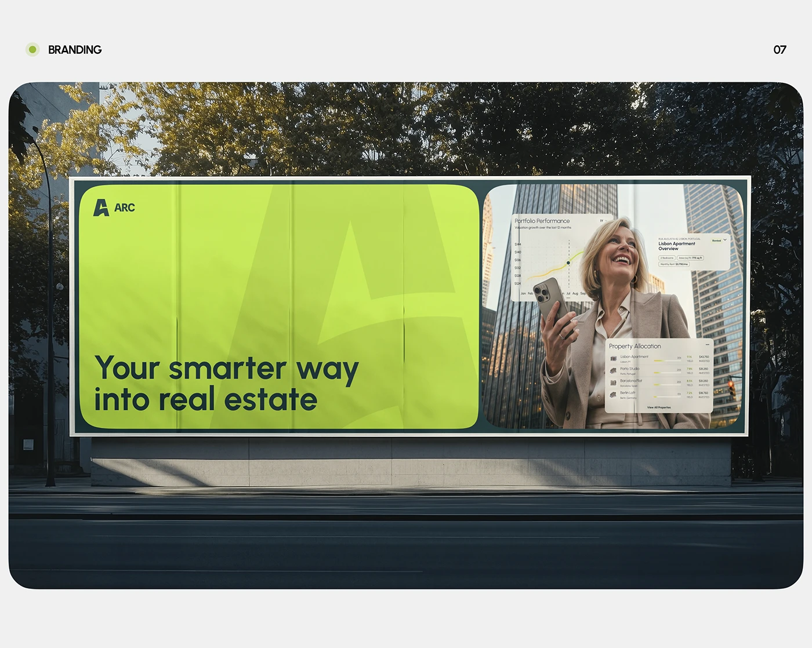

# Lime billboard with giant faint monogram and photo panel of UI overlay

**Discipline:** branding ·  · **Design style:** Dark & Neon
**Tags:** billboard, outdoor, lime, monogram, real-estate, photo-panel, rounded, mockup

## What it is
A slide with a rounded photo of a roadside billboard among trees. The billboard has two rounded panels in a dark teal frame: a lime one with a large faint 'A' monogram, logo and headline 'Your smarter way into real estate', and a photo of a smiling woman with a phone and floating UI cards.

## What it means
Confident and modern; lime pops strongly against the dark trees and asphalt.

## Techniques
- Split a billboard into a colour panel and a photo panel with rounded corners.
- Use an oversized faint monogram inside the colour block.
- Layer UI cards on the photo to show the product.
- Shoot the mockup in dark natural surroundings so lime stands out.

## Best for
- Out-of-home advertising concepts
- Fintech and property brands
- Identity presentations

## Vocabulary
- **OOH** — Out-of-home advertising, such as billboards.
- **Faint monogram** — A large low-contrast initial used as a watermark.
- **Split billboard** — A billboard divided into two panels.
- **Product overlay** — UI elements placed on a photo.
