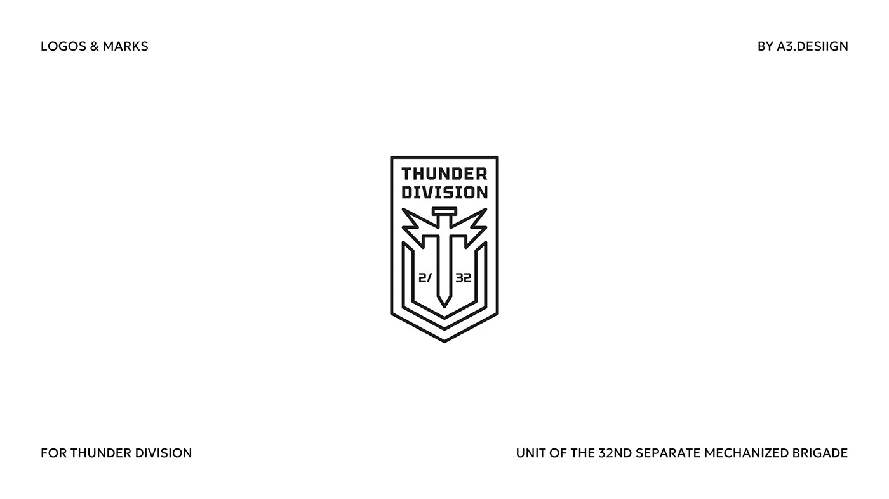

# Monoline pennant shield with upright sword and lightning wings for a military unit

**Discipline:** branding ·  · **Design style:** Dark & Neon
**Tags:** badge, shield, monoline, military, black-and-white, sword, lightning, emblem

## What it is
A white slide with small caps corner labels and a black outline pennant shield holding the text 'THUNDER DIVISION', a sword with jagged lightning crosspieces, nested chevron lines and '2/32'.

## What it means
Disciplined and heraldic; uniform line weight keeps it crisp for patches.

## Techniques
- Build a badge from nested uniform lines.
- Turn a sword's crossguard into lightning wings.
- Set text in a squared display face inside the shield.
- Keep in black line on white.

## Best for
- Military, sports and gaming emblems
- Patches and embroidery
- Heraldic monoline marks

## Vocabulary
- **Pennant shield** — A shield with a pointed bottom.
- **Nested chevrons** — V-shaped lines placed inside each other.
- **Patch-ready** — Simple enough to be embroidered.
- **Monoline badge** — An emblem drawn with one stroke weight.
