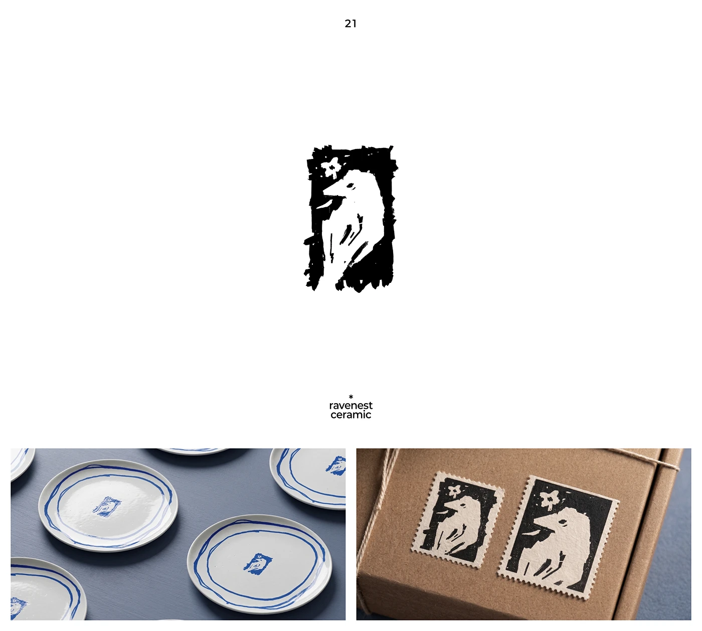

# Rough linocut raven with a flower in a frame, printed blue on plates and as black perforated stamps on a kraft box

**Discipline:** branding ·  · **Design style:** Warm & Organic
**Tags:** logo, linocut, raven, ceramic, stamp, kraft, blue, hand-made

## What it is
A white slide with a chunky black linocut-style raven silhouette with a small white flower inside a rough rectangular frame, the caption 'ravenest ceramic', and two photos: blue-printed marks in the middle of white plates with hand-drawn blue rings, and two cream-and-black stamps with perforated edges on a kraft parcel.

## What it means
Handmade and characterful; the rough print texture feels artisan and collectable.

## Techniques
- Draw the mark as a rough linocut print.
- Print it in blue on ceramics.
- Make it a perforated postage stamp on packaging.
- Frame with ragged edges.

## Best for
- Ceramics and craft brands
- Stamp-like marks
- Artisan packaging

## Vocabulary
- **Linocut style** — A bold relief-print look with rough edges.
- **Perforated stamp** — A label with postage-stamp edges.
- **Underglaze blue** — A cobalt blue used on ceramics.
- **Ragged frame** — An uneven rough border.
