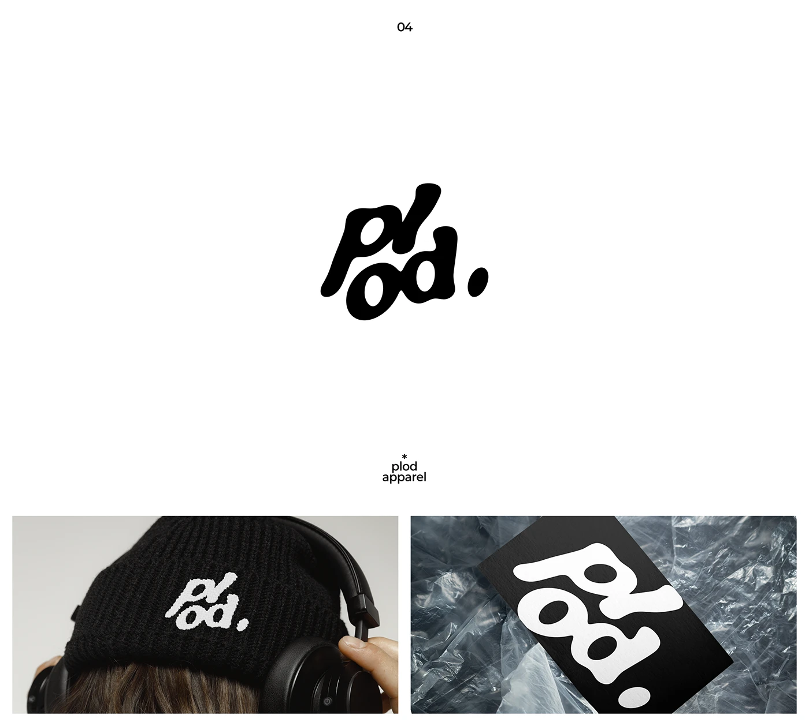

# Melting blob wordmark on a knit beanie and a black card on crumpled plastic

**Discipline:** branding ·  · **Design style:** Glassmorphism
**Tags:** wordmark, liquid, blob-type, black-and-white, apparel, beanie, business-card, organic

## What it is
A white slide with a black, wobbly stacked wordmark 'plod.' whose letters melt into each other, followed by two applications: a black beanie with the mark embroidered in white, worn with headphones, and a black card with a reversed giant mark on crumpled silvery plastic.

## What it means
Cool, soft and youthful; distorted letters feel like a liquid streetwear brand.

## Techniques
- Warp heavy letters into a wobbly liquid shape and stack them.
- Keep it strictly black and white so it embroiders and prints cleanly.
- Enlarge and crop the mark on small items like cards.
- Photograph on tactile materials (plastic, knit).

## Best for
- Streetwear, music and culture brands
- Merch-led identities
- Playful minimal marks

## Vocabulary
- **Liquid type** — Letters distorted into soft blobby shapes.
- **Stacked wordmark** — A name arranged on two lines.
- **Reversed mark** — A logo in white on black.
- **Tactile mockup** — Application shown on a material with strong texture.
