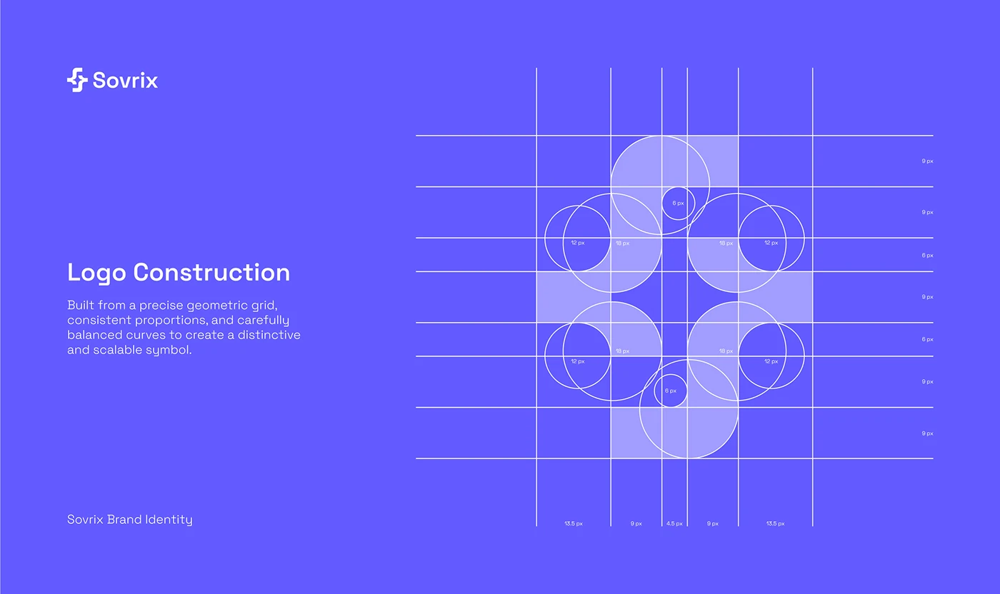

# Violet construction sheet: Sovrix symbol on a grid of overlapping circles and labelled pixel measurements

**Discipline:** branding · **Design type:** Logo guidelines
**Tags:** logo, construction, violet, white-lines, grid, circles, measurements, guidelines

## What it is
A violet slide with the logo at the top left, a 'Logo Construction' heading and description, and at the right a translucent lilac symbol over white grid lines and overlapping circles labelled with 12, 18 and 6 px radii and edge measurements.

## What it means
Precise and reassuring; showing the geometry proves the mark is engineered.

## Techniques
- Overlay circles and lines on the symbol.
- Label radii and spacings in pixels.
- Keep it tone-on-tone violet.
- Write a short explanatory paragraph.

## Best for
- Logo construction pages
- Brand guidelines
- Geometric symbols

## Vocabulary
- **Construction grid** — Lines and circles showing how a logo is built.
- **Radius label** — A measure of a circle's size.
- **Tone-on-tone** — Two shades of the same hue.
- **Scalable symbol** — A mark that works at any size.
