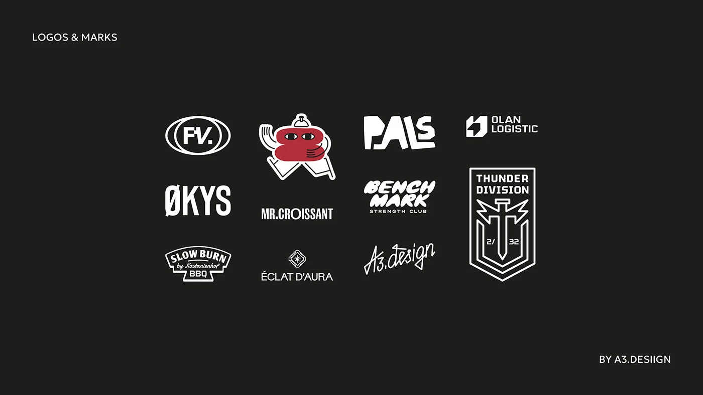

# Grid of eleven diverse white logos on charcoal: badges, wordmarks, mascot and crest

**Discipline:** branding ·  · **Design style:** Playful & Illustrated
**Tags:** logo-collection, white-on-dark, badges, mascot, script, crest, monogram, grid

## What it is
A charcoal slide with a tidy 4x3 arrangement of white logos of very different styles: an oval monogram, a character mascot in red, a cut-paper wordmark, a logistics symbol, condensed wordmarks, a script signature, a badge, a diamond emblem and a shield crest.

## What it means
Shows range at a glance; dark uniform background lets every style read equally.

## Techniques
- Reverse all logos to white on a single dark field.
- Keep sizes and spacing consistent for comparison.
- Introduce one colour accent (the red mascot) as a focal point.
- Add tiny title and credit labels.

## Best for
- Logo portfolio overviews
- Comparing identity styles
- Designer self-promotion

## Vocabulary
- **Logo sheet** — A grid showing many logos together.
- **Reversed logo** — A logo shown light on dark.
- **Badge logo** — A logo enclosed in an emblem shape.
- **Focal accent** — One coloured item among monochrome ones.
