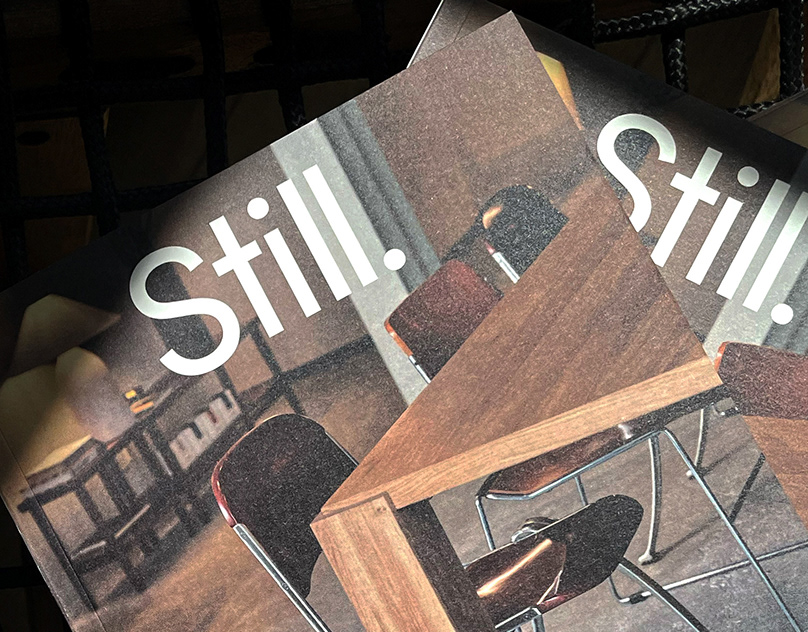

# Printed magazine covers with a large white 'Still.' wordmark over a moody chair-and-table photo

**Discipline:** branding ·  · **Design style:** Editorial
**Tags:** editorial, magazine, print, white-wordmark, dark, interior, grain, cover

## What it is
Overlapping printed covers on a dark rope net showing a warm, grainy interior photograph of walnut table and leather chairs, with a big white geometric sans 'Still.' at the top.

## What it means
Quiet and tactile; the full-stop and calm photo say slowness.

## Techniques
- Set a huge white wordmark over a moody photo.
- Use a full stop as part of the name.
- Show covers overlapping on a dark surface.
- Rely on paper grain.

## Best for
- Magazines and editorial brands
- Interior and lifestyle publications
- Print identity covers

## Vocabulary
- **Cover wordmark** — A masthead set large on a cover.
- **Paper grain** — Visible texture from printing on paper.
- **Overlapping stack** — Copies fanned on top of each other.
- **Period wordmark** — A name that ends with a full stop.
