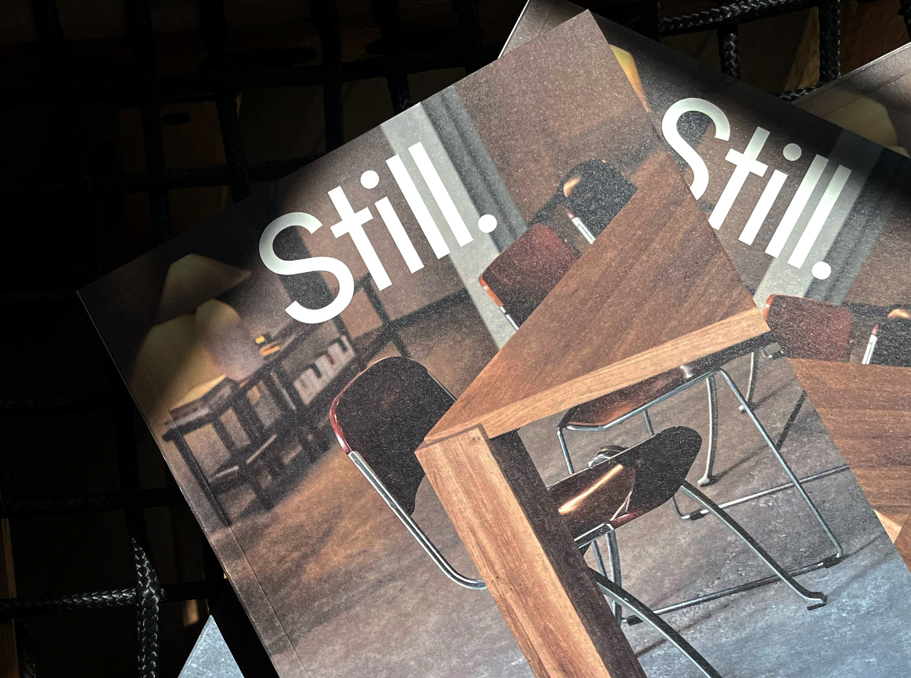

# Large view of the printed 'Still.' covers with visible paper grain

**Discipline:** branding · **Design type:** Editorial branding
**Tags:** editorial, magazine, print, white-wordmark, interior, grain, dark, cover

## What it is
A larger version of the two magazine covers, showing stark white lettering, chairs and a walnut table corner in warm light against a black rope net.

## What it means
Contemplative and premium; texture and shadow feel analogue.

## Techniques
- Let the photo crop diagonally across the cover.
- Photograph in raking light.
- Keep only one text element.
- Use dark surroundings.

## Best for
- Editorial identity presentations
- Print showcase photography
- Interior-focused magazines

## Vocabulary
- **Raking light** — Low-angle light that shows texture.
- **Single-element cover** — A cover with only the masthead.
- **Dark surround** — A black background that isolates the print.
- **Analogue feel** — A look evoking film and paper.
