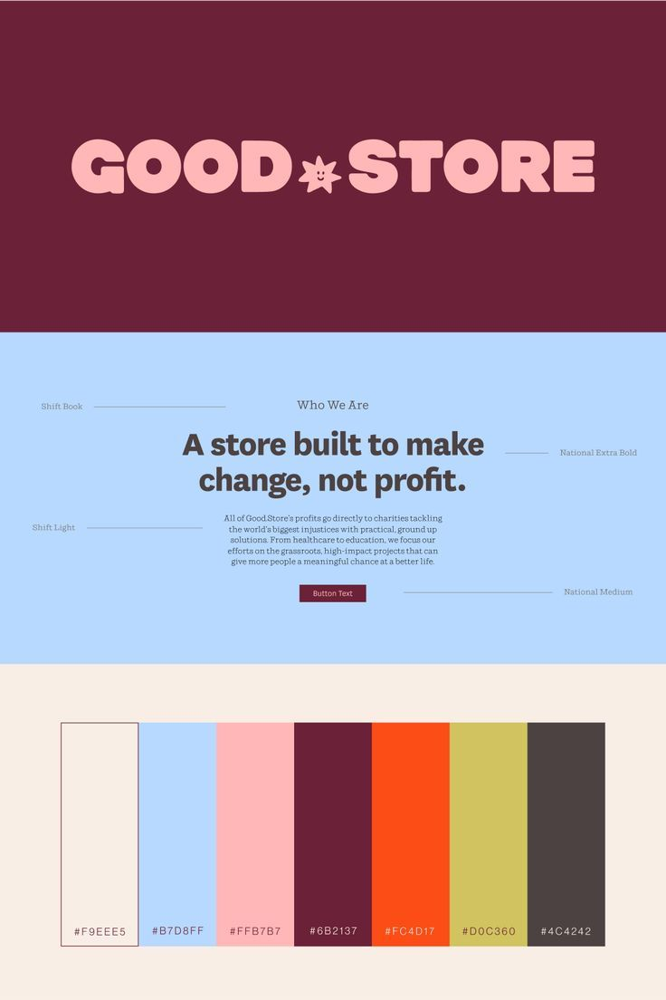

# Maroon and Pink Star Wordmark Board

**Discipline:** branding ·  · **Design style:** Playful & Illustrated
**Tags:** wordmark, maroon, pink, sky-blue, palette, type-specimen, charity, playful

## What it is
A three-band board: a maroon panel with a chunky pink wordmark 'GOOD*STORE' with a smiling star, a sky-blue panel with a website statement annotated with typeface names, and a cream band with seven colour swatches and hex codes.

## What it means
A warm, sweet palette and bubbly letters give a cause-driven store an optimistic, friendly voice, and annotations link type to use.

## Techniques
- Chunky rounded wordmark with a character-star as the divider
- Labeled leader lines naming the typeface for each text role
- Seven-swatch strip with names and hex codes
- Blue mock section showing the type in context
- Contrast of a slab-like serif body against a heavy sans headline

## Best for
- Social enterprise and charity brands
- Retail identity documentation
- Playful yet trustworthy identities

## Vocabulary
- **Type annotation** — A leader line labelling which typeface is used where.
- **Swatch strip** — A row of adjacent colour samples with codes.
- **Character glyph** — A small mascot or star used in place of punctuation or a letter.
