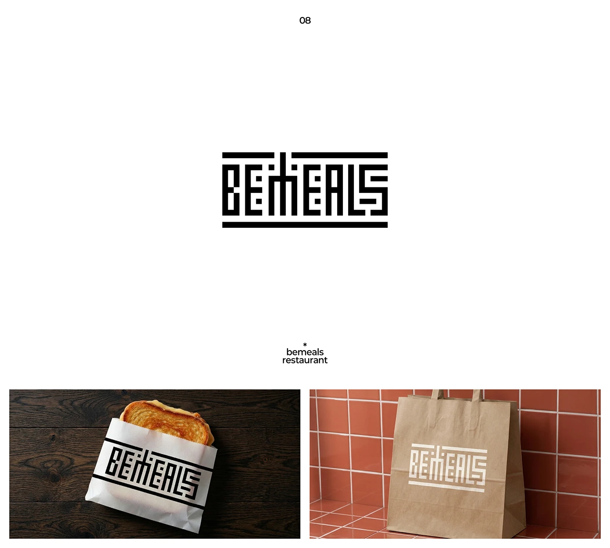

# Pixel-maze wordmark on wrappers and kraft bags

**Discipline:** branding · **Design type:** Wordmarks
**Tags:** wordmark, grid-type, maze, black-and-white, restaurant, packaging, geometric

## What it is
A black wordmark built from rectangular strokes and dots, forming a maze-like lettering of 'bemeals' between two heavy bars. It is applied on a sandwich wrapper on dark wood and reversed out of a kraft paper bag against terracotta tiles.

## What it means
Bold, codelike and playful, with a puzzle quality that invites a second look.

## Techniques
- Construct every letter from a square grid so the word looks like a maze or barcode.
- Frame the word between heavy horizontal bars for a stamp-like lockup.
- Use it as a repeating band on packaging.
- Show positive and reversed versions on contrasting materials.

## Best for
- Restaurants, delivery and packaging
- Tech and design brands wanting a codelike mark
- Brands that work as stamps or labels

## Vocabulary
- **Grid lettering** — Letters built on a square module.
- **Stamp lockup** — A logo arranged like a rubber stamp.
- **Reversed logo** — A logo in light on dark.
- **Wrap band** — A logo repeated as a stripe across packaging.
