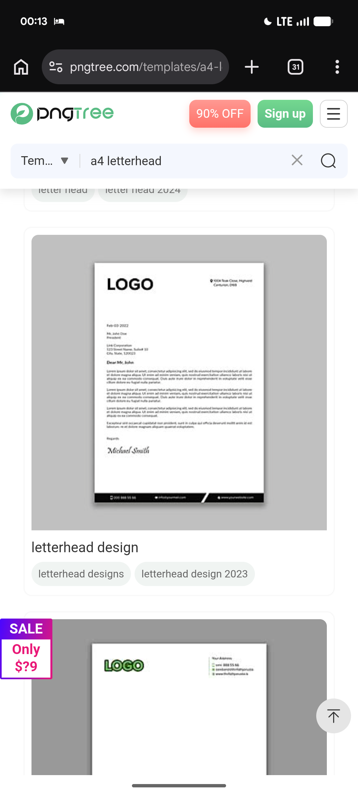

# Minimal Black Letterhead with Slash Footer

**Discipline:** branding ·  · **Design style:** Minimalist
**Tags:** letterhead, minimal, black-white, footer-bar, script-signature, stationery

## What it is
A grey backdrop with a white A4 sheet: a bold black LOGO at the top left, a small address at the top right, a dated letter with a script signature and a black footer bar with contact items divided by a white diagonal slash, and below it another sheet with a green outlined logo.

## What it means
Almost no decoration makes the page feel serious and easy to reuse, and one slash in the footer adds a small graphic signature.

## Techniques
- Bold wordmark and tiny address as the only header
- Footer bar with a diagonal notch
- Script signature for a personal touch
- Plenty of white space around the letter
- Second sheet using a coloured outline logo

## Best for
- Minimal corporate identities
- Professional letter templates
- Monochrome stationery

## Vocabulary
- **Footer bar** — A solid strip at the base of a page holding contact items.
- **Notch slash** — A diagonal cut used to divide items in a bar.
- **Script signature** — A handwritten-style sign-off.
