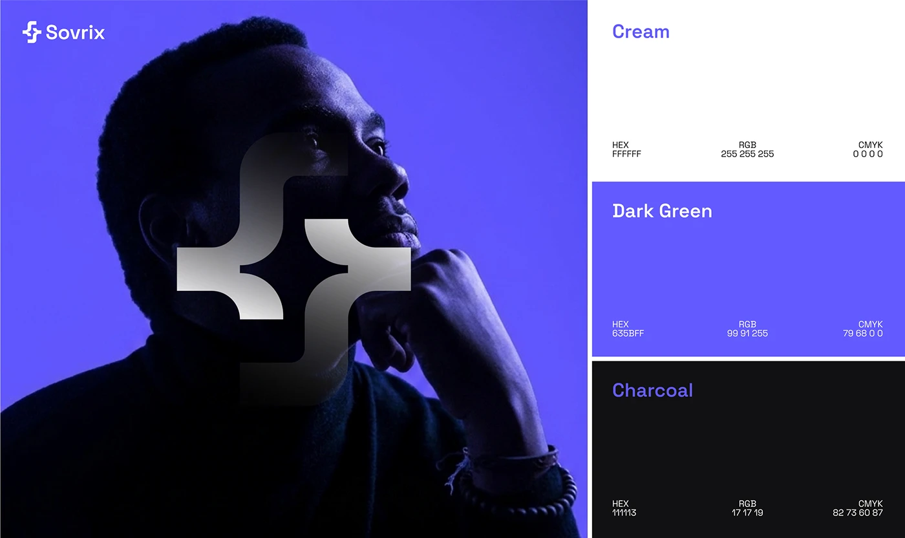

# Semi-transparent chrome symbol over a violet-lit profile, with cream, violet and charcoal spec cards

**Discipline:** branding ·  · **Design style:** 3D & Surreal
**Tags:** logo, brand-board, violet, charcoal, portrait, chrome-gradient, palette, spec

## What it is
A board with a violet-toned side-profile portrait of a man with a large silver-gradient version of the modular symbol overlaid and the logo at the top left, and at right three stacked colour cards (white, violet, charcoal) with HEX, RGB and CMYK values.

## What it means
Thoughtful and premium; a chrome symbol over a face signals intelligence.

## Techniques
- Overlay a gradient logo on a duotone portrait.
- Stack colour spec cards on one side.
- List HEX, RGB and CMYK.
- Keep a single violet dominating.

## Best for
- Brand boards with photography
- Tech identity presentations
- Palette and image combos

## Vocabulary
- **Logo overlay** — A large logo placed over a photo.
- **Chrome gradient** — A metallic silver blend.
- **Spec card** — A card listing colour values.
- **Duotone portrait** — A portrait rendered in two colours.
