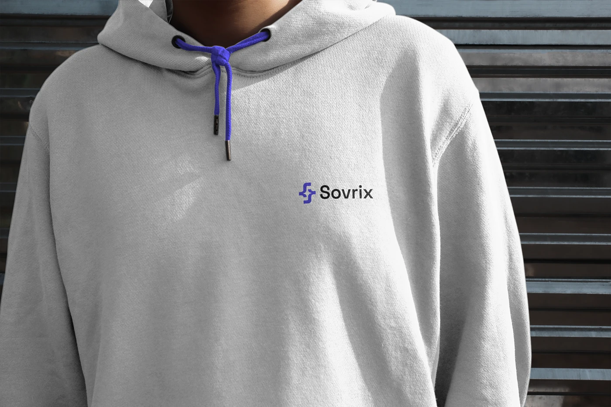

# Violet and black logo lockup embroidered on a grey hoodie with a violet drawstring

**Discipline:** branding ·  · **Design style:** Neo-Brutalist
**Tags:** apparel, hoodie, embroidery, violet, grey, drawstring, logo, street

## What it is
A close-up of a person in a grey hoodie with a violet drawstring against a dark slatted wall, with a small embroidered violet symbol and black 'Sovrix' on the chest.

## What it means
Understated and cool; a small chest logo and matching drawstring say tasteful merch.

## Techniques
- Embroider a small horizontal lockup at the chest.
- Match a drawstring to the brand colour.
- Use a neutral grey garment.
- Shoot in raking light.

## Best for
- Startup and tech merch
- Understated apparel branding
- Colour accents on neutral garments

## Vocabulary
- **Chest embroidery** — A small stitched logo on the chest.
- **Accent drawstring** — A coloured cord on a hoodie.
- **Neutral garment** — A grey or white piece of clothing.
- **Small lockup** — A logo used at a small scale.
