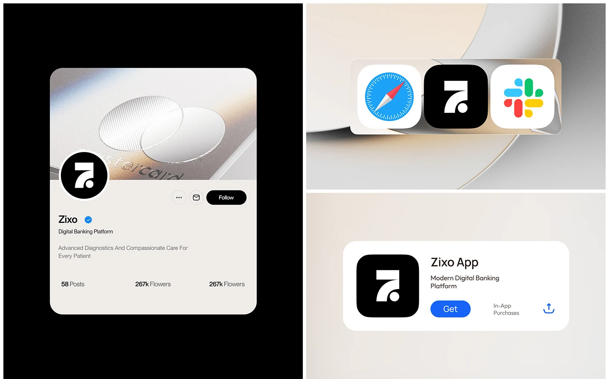

# Black 7-monogram on a social profile, app icon shelf and store listing

**Discipline:** branding · **Design type:** Brand application mockups
**Tags:** monogram, app-icon, social-profile, black-and-white, warm-grey, fintech, digital-application

## What it is
A three-part board. Left: a rounded warm-grey profile card over black with a metallic card banner, a black circular avatar with a white geometric '7', name, verified tick and follow button. Top right: a frosted shelf holding Safari, the black app icon and Slack. Bottom right: an app-store style listing card with the icon and a blue Get button.

## What it means
Crisp and trustworthy; a one-colour icon fits comfortably beside real apps.

## Techniques
- Test the logo as an app icon between well-known ones.
- Use a black avatar with a white symbol for strong recognition.
- Present applications in realistic UI cards on a soft beige gradient.
- Use a metallic macro image as a banner.

## Best for
- Fintech and app brand presentations
- Icon and avatar testing
- Digital-first identity systems

## Vocabulary
- **App icon test** — Placing a brand icon among other app icons to check impact.
- **Avatar lockup** — A logo used as a profile picture.
- **Store card** — An app listing block with icon, name and Get button.
- **Frosted shelf** — A translucent bar holding icons.
