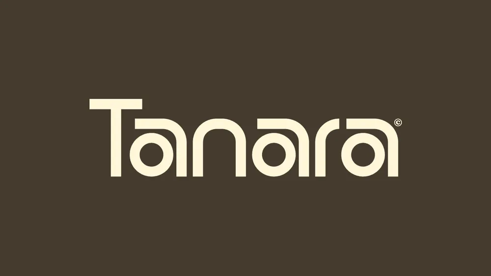

# Cream 'Tanara' wordmark with rounded pill-shaped letters and open counters on dark brown

**Discipline:** branding · **Design type:** Wordmarks
**Tags:** wordmark, geometric, pill-letters, cream, brown, monoline, copyright-mark, warm

## What it is
A dark olive-brown field with a cream wordmark 'Tanara' built from uniform-weight strokes: a T with a long crossbar, round or stadium-shaped a and n forms with open counters, and a small © mark.

## What it means
Warm and modern; stadium-shaped letters feel friendly and geometric.

## Techniques
- Build letters from equal-weight stadium shapes.
- Keep the counters open and round.
- Use cream on dark brown.
- Add a small © mark.

## Best for
- Lifestyle and hospitality brands
- Geometric wordmarks
- Warm two-colour logos

## Vocabulary
- **Stadium shape** — A rectangle with fully rounded ends.
- **Uniform stroke** — A constant line weight across letters.
- **Open counter** — An enclosed letter space left open in the design.
- **Warm duo** — Cream and brown as a colour pair.
