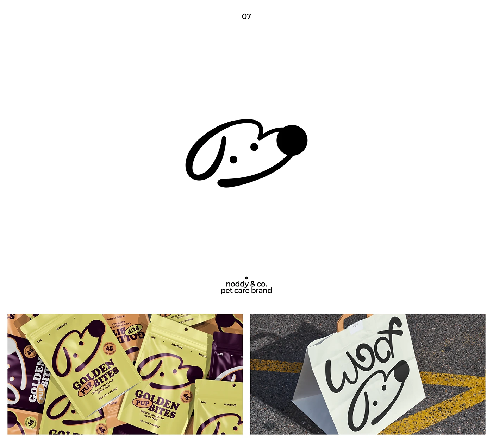

# One-line dog head symbol with treat bags and paper carrier

**Discipline:** branding ·  · **Design style:** Warm & Organic
**Tags:** logo, symbol, monoline, dog, pet-care, packaging, yellow-green, hand-lettering

## What it is
A white slide with a single continuous black line drawing of a dog head with two dots for eyes and a solid round nose, above two application photos: resealable treat pouches in acid yellow, terracotta and aubergine with the dog symbol and bold serif type, and a white paper bag on asphalt with hand-lettered 'Woof' curling into the symbol.

## What it means
Cute, witty and warm; the single stroke feels affectionate and hand-made.

## Techniques
- Draw a mascot in one continuous stroke with a solid dot for emphasis.
- Vary the mark's scale and rotation across pack graphics.
- Combine fat retro serif with the line-art symbol.
- Let hand-lettering flow into the mascot on a bag.

## Best for
- Pet care and food brands
- Friendly, quirky identities
- Packaging with pattern repeats

## Vocabulary
- **Continuous line drawing** — A drawing made with one unbroken stroke.
- **Mascot mark** — A logo built from a character.
- **Pouch pattern** — A repeated logo across packaging.
- **Hand-lettering** — Custom-drawn text instead of a typeface.
