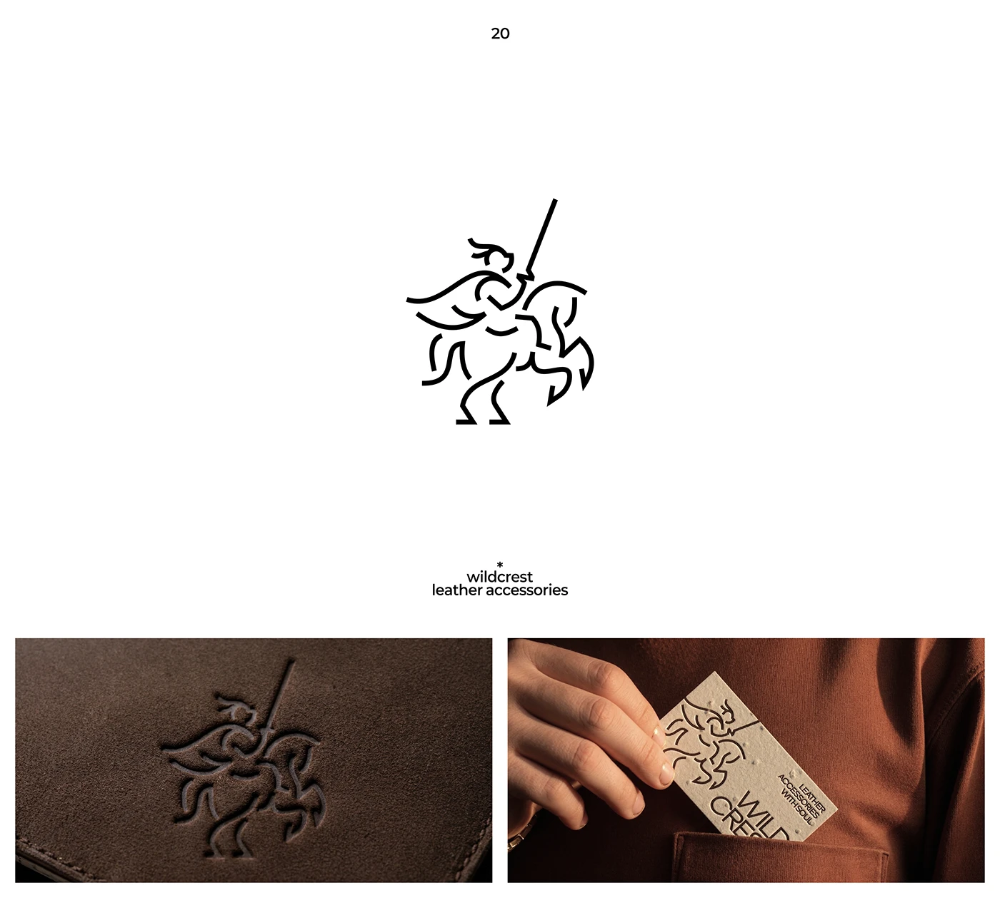

# Single-line knight on a rearing horse, blind-embossed on suede and on a seeded-paper card

**Discipline:** branding · **Design type:** Logo with symbol
**Tags:** logo, monoline, knight, emboss, leather, business-card, brown, heraldic

## What it is
A white slide with a black monoline knight with sword on a rearing horse, the caption 'wildcrest leather accessories', and two photos: the mark debossed into brown suede and a cream speckled card with the mark and vertical text held against a rust shirt pocket.

## What it means
Adventurous and crafted; a single line feels hand-drawn and works well pressed into leather.

## Techniques
- Draw an animated figure in one line weight.
- Deboss the mark into suede.
- Print on speckled seeded paper.
- Show against warm rust fabric.

## Best for
- Leather goods and craft brands
- Monoline illustrative logos
- Tactile stationery

## Vocabulary
- **Monoline illustration** — A drawing in a single line weight.
- **Deboss** — A design pressed into a surface.
- **Seeded paper** — Paper with visible fibre flecks.
- **Craft mark** — A logo suited to hand-made goods.
