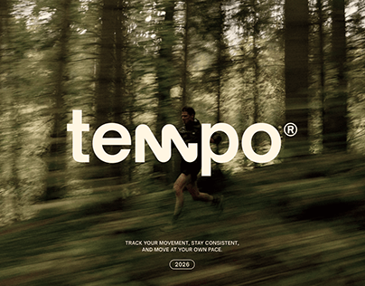

# Fitness brand cover: cream wordmark with wave m over a motion-blurred forest runner

**Discipline:** branding · **Design type:** Brand campaign cover
**Tags:** fitness, wordmark, motion-blur, forest, cream, tagline, tracking-app

## What it is
A green forest photograph blurred sideways with a trail runner sharp in the middle. A large cream lowercase 'tempo' overlays it, with the m and p connected by a wave line and a registered mark. A three-line tagline and '2026' pill sit at the bottom.

## What it means
Fluid, calm and athletic; the wave in the m visualises rhythm and pace.

## Techniques
- Use directional motion blur in the background to imply speed.
- Put a light lowercase wordmark on the image with a single distinctive letter modification.
- Keep text small and centred beneath.
- Use a natural muted green palette.

## Best for
- Fitness, running and tracking apps
- Wordmarks that signal movement
- Campaign covers with photography

## Vocabulary
- **Motion blur** — A streak effect that suggests movement.
- **Wave ligature** — A wave-shaped connection between letters.
- **Lowercase wordmark** — A logo set in all lowercase letters.
- **Photo-led cover** — A cover where a photo carries the mood.
