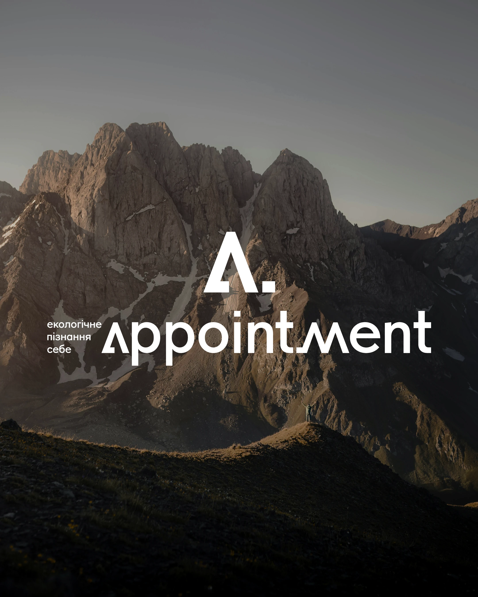

# White geometric 'A.' and 'appointment' wordmark over a darkened mountain range

**Discipline:** branding ·  · **Design style:** Geometric & Bauhaus
**Tags:** wordmark, monogram, mountain, white, dark-photo, ukrainian, nature, geometric

## What it is
A darkened alpine photo with a small figure on a ridge. A large white geometric A with a full stop sits above a lowercase wordmark where the As are open triangles and the m has peaked strokes, with a small Ukrainian tagline on the left.

## What it means
Grounded and aspirational; the triangular letters echo peaks.

## Techniques
- Shape letters to echo the imagery (peaks).
- Overlay pure white type on a dimmed landscape.
- Pair a monogram with a full wordmark.
- Include a tiny figure for scale.

## Best for
- Wellness, outdoor and education brands
- Wordmarks inspired by landscape
- Photo-based brand covers

## Vocabulary
- **Peak letterform** — A letter shaped like a mountain.
- **Landscape overlay** — Type placed over a scenic photo.
- **Monogram and wordmark** — Initial mark plus full name.
- **Scale figure** — A tiny person showing scale.
