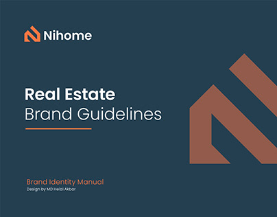

# Navy brand-guidelines cover with orange house-N logo and a giant copper-brown fragment

**Discipline:** branding ·  · **Design style:** Warm & Organic
**Tags:** guidelines, cover, navy, copper, orange, real-estate, logo, house-symbol

## What it is
A navy cover with a small orange and white house-shaped 'N' logo and wordmark, a title 'Real Estate Brand Guidelines' with an orange rule, 'Brand Identity Manual' credit at the bottom and a huge copper-brown angular fragment of the logo at the right.

## What it means
Professional and grounded; a giant cropped logo detail adds confidence.

## Techniques
- Crop the logo huge as a graphic.
- Use an orange rule under the title.
- Combine navy with copper and orange.
- Keep small credits at the bottom.

## Best for
- Brand manual covers
- Real-estate identities
- Cropped-logo graphics

## Vocabulary
- **Cropped logo graphic** — A magnified part of the logo as an image.
- **Manual cover** — The first page of a brand guide.
- **Title rule** — A short line under a heading.
- **House symbol** — A logo suggesting a home.
