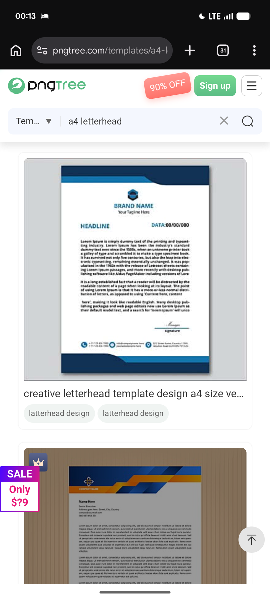

# Navy Hex Letterhead and Orange-Blue Angle Header

**Discipline:** branding ·  · **Design style:** Warm & Organic
**Tags:** letterhead, navy, hexagon, orange, blue, angular, stationery

## What it is
Two letterheads: a navy and sky-blue sheet with a hexagon logo, headline, date and heavy top and bottom curved bands, and a sheet on a brown wood-grain ground with an angular blue and orange header over a small ornament logo.

## What it means
Curved versus angular corner bands give different personalities, calm corporate or energetic, using the same page structure.

## Techniques
- Heavy curved bands top and bottom
- Angular stacked stripes in blue and orange
- Centred logo over a headline row
- Warm wood backdrop behind a cool sheet
- Icon contact row above the footer band

## Best for
- Corporate stationery comparisons
- Letterhead template shops
- Colour-blocked header design

## Vocabulary
- **Colour band** — A block of solid colour spanning the page width.
- **Angular header** — A header built from diagonal slices of colour.
- **Wood-grain backdrop** — A wood texture used as a mockup surface.
