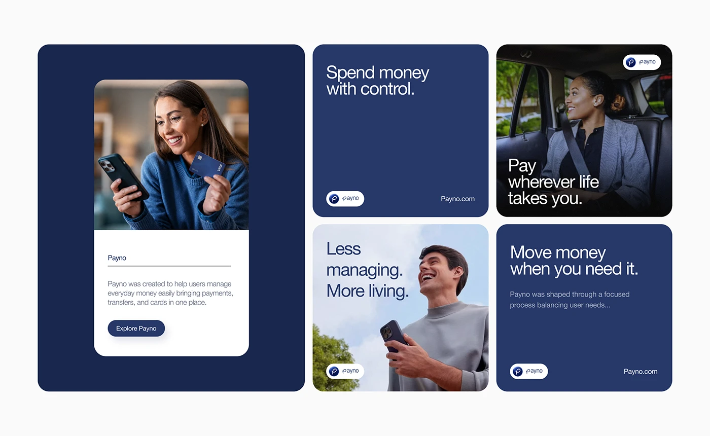

# Navy Brand Tiles with Portraits and Copy Cards

**Discipline:** branding ·  · **Design style:** Geometric & Bauhaus
**Tags:** navy, tiles, portraits, copy, script-logo, rounded, fintech

## What it is
A pale board with a large navy panel holding a white card with a woman showing her phone and card and an 'Explore Payno' button, and four rounded tiles alternating navy copy cards ('Spend money with control.', 'Move money when you need it.') and photos with headlines.

## What it means
Alternating solid navy copy tiles and warm photos create rhythm, and identical corner radii unify them.

## Techniques
- Alternate copy tiles and photo tiles
- Large navy panel framing an inner card
- Short headlines in sans with tight leading
- Pill logo lockup and URL in each tile corner
- Warm candid photography against cool navy

## Best for
- Fintech brand collages
- Social and web tile systems
- Copy and photo grids

## Vocabulary
- **Copy tile** — A tile containing only a headline and brand marks.
- **Photo tile** — A tile with a photograph and overlaid headline.
- **Inner card** — A card nested within a larger coloured panel.
