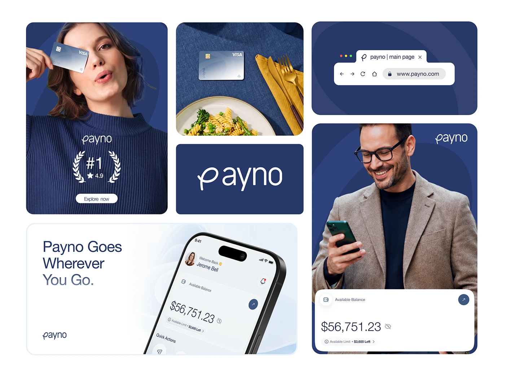

# Navy fintech identity as a modular rounded-card collage

**Discipline:** branding ·  · **Design style:** Corporate & Clean-Tech
**Tags:** fintech, navy, collage, bento, photography, logo, card-ui, brand-board

## What it is
A board of rounded rectangles: a woman covering one eye with a bank card, a card on a navy tablecloth with pasta and golden cutlery, a browser bar, a large navy logo tile, a phone mock on pale blue with 'Payno Goes Wherever You Go', and a man with a phone plus balance card.

## What it means
Warm, human and premium; navy stays consistent while photos and props bring personality.

## Techniques
- Arrange brand assets as a bento of rounded tiles with different content types.
- Style photos with navy clothing and props so the brand colour appears in real life.
- Include a plain logo tile to give the mark room to breathe.
- Combine lifestyle photography with real UI cards floating over it.

## Best for
- Brand identity presentations
- Fintech launch boards
- Showing range of brand voice

## Vocabulary
- **Brand board** — A single image summarising a brand's look.
- **Bento layout** — Rounded tiles of varying size in a grid.
- **Prop styling** — Choosing objects that echo brand colours.
- **UI overlay** — Interface cards laid over photography.
