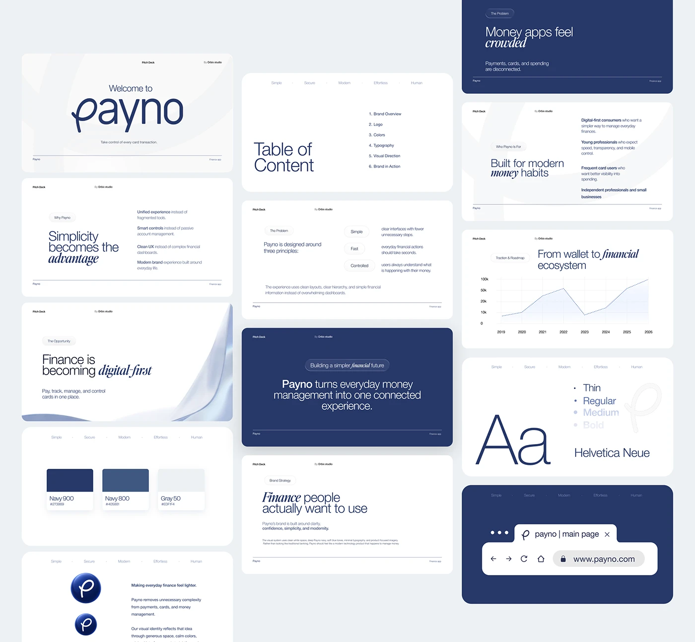

# Board of fintech pitch-deck slides in white and navy with italic serif keywords, palette, type and browser tab

**Discipline:** branding ·  · **Design style:** Editorial
**Tags:** pitch-deck, navy, white, italic-serif, logo, palette, typography, slides

## What it is
A grid of rounded slides: a large script wordmark welcome, a table of contents, problem, opportunity and traction slides with an italic serif keyword in each headline, a chart with a dotted line, a navy statement slide, palette swatches (Navy 900, Navy 800, Gray 50), a giant 'Aa' Helvetica Neue with weight list, logo variants and a navy browser-tab mockup.

## What it means
Calm and credible; one navy plus white space and italic accents give a fintech quiet authority.

## Techniques
- Set one word per headline in italic serif.
- Alternate white and navy slides.
- Show palette as simple cards.
- Present a browser tab as a logo application.

## Best for
- Fintech pitch and brand decks
- Navy identity presentations
- Slide systems with a repeated header

## Vocabulary
- **Italic keyword** — One word in italic serif for emphasis.
- **Slide rhythm** — Alternating white and navy slides.
- **Running header** — Small labels repeated across slides.
- **Browser tab mockup** — A logo shown in a tab and URL bar.
