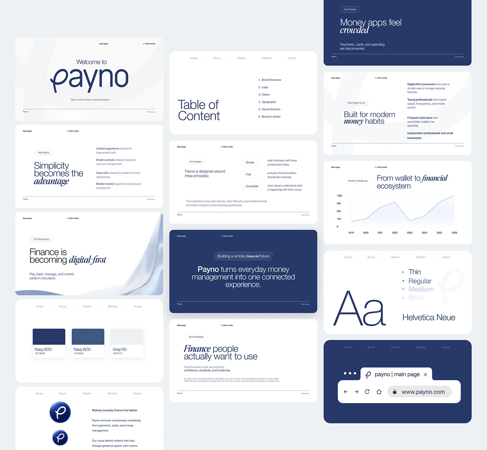

# Navy and white brand pitch deck with italic serif emphasis and tab-like browser slide

**Discipline:** branding · **Design type:** Brand guidelines deck
**Tags:** brand-deck, navy, white, italic-serif, slides, typography, colour, browser-mockup

## What it is
A grid of about a dozen slides for a finance-app brand: a title with a large script wordmark, a table of contents, statement slides where one word is bold italic serif, a traction chart with a dotted line, palette swatches, a type specimen ('Aa' with weight list), a logo page and a browser bar mockup on navy.

## What it means
Refined and trustworthy; white space and a single navy give it institutional calm while italic serif adds personality.

## Techniques
- Set one word per headline in italic serif for emphasis.
- Repeat a thin header with brand keywords across slides.
- Alternate white and navy slides to create rhythm.
- Show type as a giant 'Aa' with a weight list.
- Use a dotted-line chart with a light fill.

## Best for
- Brand guidelines and pitch decks
- Fintech and professional service brands
- Design system introductions

## Vocabulary
- **Italic emphasis** — Setting a key word in italic serif inside sans text.
- **Type specimen** — A showcase of a typeface's forms and weights.
- **Running header** — Small repeated text at the top of every slide.
- **Slide rhythm** — Alternating slide colours to pace a deck.
