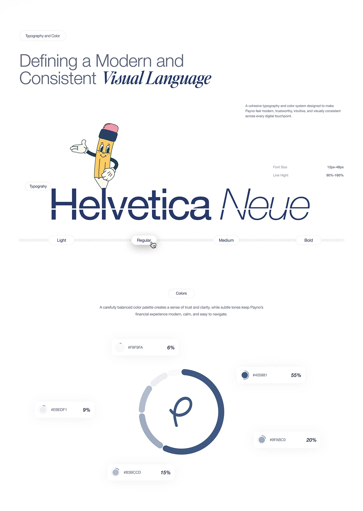

# Helvetica Neue and Colour Share Sheet

**Discipline:** branding ·  · **Design style:** Playful & Illustrated
**Tags:** typography, helvetica, navy, mascot, palette, percentages, ring

## What it is
A tall pale sheet with a mixed sans and italic serif title, a cartoon pencil mascot peeking above a giant navy 'Helvetica Neue', a weight slider (Light to Bold), and a circular palette ring with hex chips and usage percentages around a script monogram.

## What it means
Percentages on the colour ring show how much of each colour to use, and the pencil adds humour to an otherwise serious system.

## Techniques
- Colour ring segments sized by usage percentage
- Cartoon mascot leaning on the specimen
- Weight slider with tick marks and a cursor
- Sans and italic serif contrast in the title
- Floating hex chips around the ring

## Best for
- Brand guideline pages
- Fintech identity documentation
- Explaining colour proportions

## Vocabulary
- **Usage ratio** — The percentage share each colour should occupy.
- **Weight slider** — A control-like graphic showing weights from light to bold.
- **Mascot cameo** — A character placed within technical documentation for personality.
