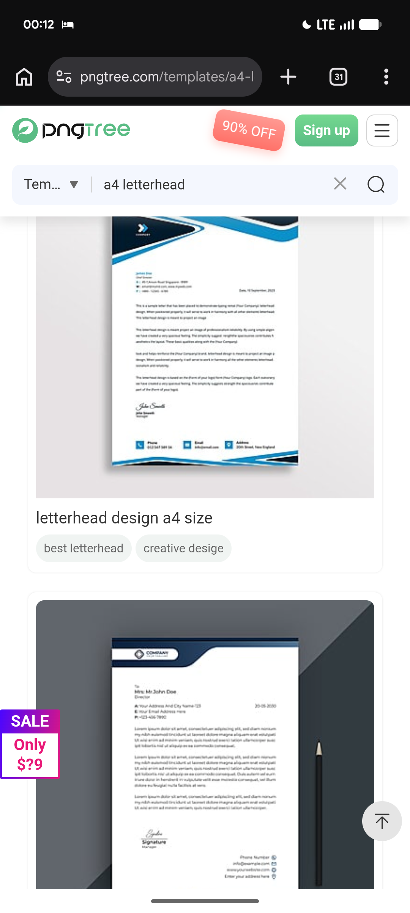

# Navy Swoosh Letterhead and Slate Desk Sheet

**Discipline:** branding ·  · **Design style:** Warm & Organic
**Tags:** letterhead, navy, blue, swoosh, slate, pencil, stationery

## What it is
Two stationery mockups from a template site: a white A4 sheet with a navy triangle logo tab and layered blue swooshes across the top and bottom, and a second sheet with a rounded navy header tab lying on a slate surface beside a black pencil.

## What it means
Flowing blue ribbons make plain paper feel dynamic, and a slate desk with a pencil sets a real-office context.

## Techniques
- Layered swoosh ribbons at top and bottom
- Logo held in a solid tab shape
- Small props such as a pencil for context
- Dark slate backdrop to make white paper glow
- Compact address block under the header

## Best for
- Business stationery presentation
- Letterhead mockups
- Corporate blue identities

## Vocabulary
- **Swoosh** — A curved ribbon shape used as a dynamic accent.
- **Logo tab** — A shaped panel that holds a logo at the page edge.
- **Desk mockup** — Stationery shown on a work surface with props.
