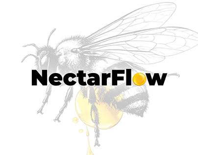

# NectarFlow wordmark over a faded engraved bee, with a honey-drop 'o'

**Discipline:** branding · **Design type:** Wordmarks · **Design style:** Minimalist
**Tags:** wordmark, honey, bee, engraving, yellow, logo

## What it is
A bold black 'NectarFlow' wordmark whose 'o' is a glossy yellow honey drop, set over a large pale pencil-engraving of a bee holding a translucent honey drop.

## What it means
Natural and premium; the engraving adds heritage while the drop adds a sweet modern accent.

## Techniques
- Replace one letter with a glossy product symbol.
- Fade a detailed engraving behind a clean wordmark.
- Use a single warm accent colour.

## Best for
- Honey and food brands
- Natural products
- Logo presentations

## Vocabulary
- **Engraving style** — Fine line illustration like old printmaking.
- **Letter substitution** — Swapping a letter for a symbol.
