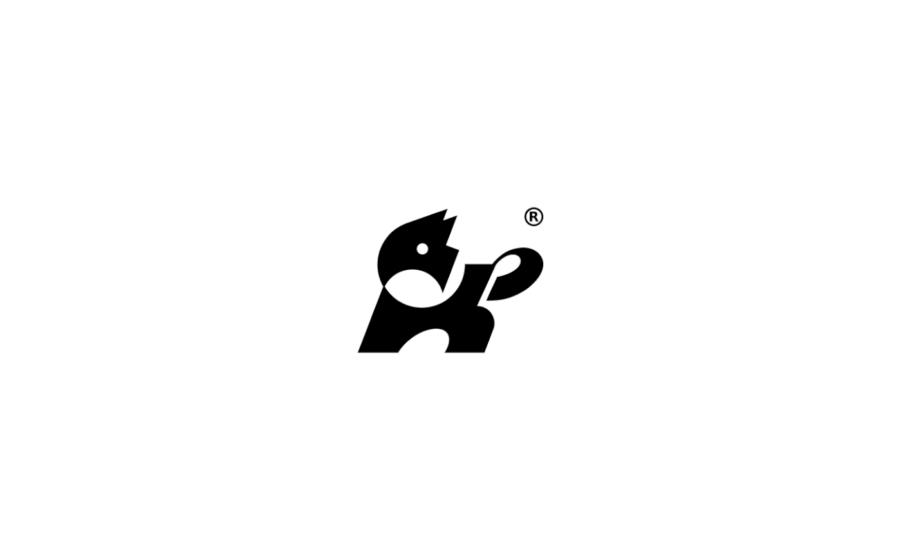

# Solid black barking-dog mark built from interlocking shapes with a registered sign

**Discipline:** branding · **Design type:** Logo with symbol
**Tags:** logo, symbol, dog, negative-space, black-and-white, geometric, animal, mascot

## What it is
A centred black symbol on white: a dog's head in profile, with an open jaw shown as a jagged cut, an eye dot, and a body shape that also forms a curled tail and a rounded paw, with a small ® beside it.

## What it means
Lively and clever; geometric cuts give the animal energy.

## Techniques
- Build an animal from a few solid shapes and cut lines.
- Use negative space for eye and jaw.
- Keep the symbol a single black colour.
- Let the tail form a secondary curl.

## Best for
- Pet brands
- Animal-based symbols
- Marks that must work at small sizes

## Vocabulary
- **Negative-space detail** — Empty areas that define features.
- **Geometric animal** — An animal simplified into basic shapes.
- **Solid mark** — A logo in one flat colour.
- **Registered sign** — The ® symbol near a mark.
