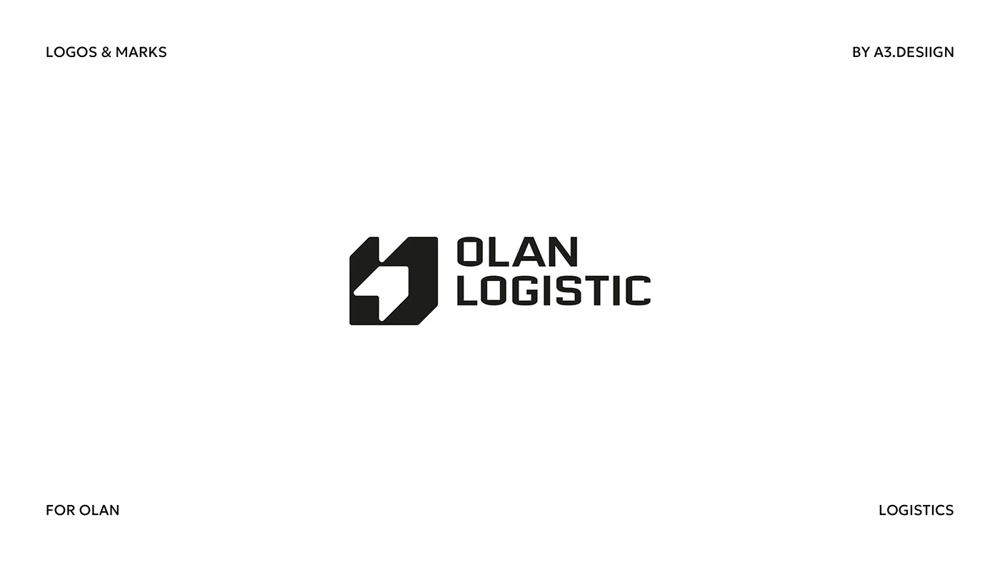

# Chamfered block symbol with cut-in arrow beside stacked condensed wordmark

**Discipline:** branding ·  · **Design style:** Minimalist
**Tags:** logo, symbol, logistics, arrow, black-and-white, chamfered, condensed, corner-labels

## What it is
A white slide with tiny corner captions and a black logo: a chamfered square mark with a white arrow shape cut into it, next to the two-line name 'OLAN LOGISTIC' in wide bold caps.

## What it means
Solid and directional; the box with arrow says parcel in motion.

## Techniques
- Cut an arrow as negative space in a solid box.
- Chamfer corners to imply a package.
- Stack the name on two lines beside the mark.
- Use tiny caps captions to frame.

## Best for
- Logistics and delivery brands
- Icon-plus-wordmark marks
- Industrial identities

## Vocabulary
- **Chamfer** — A bevelled corner.
- **Negative arrow** — An arrow formed by empty space.
- **Stacked name** — A brand name set on two lines.
- **Package metaphor** — A box shape suggesting parcels.
