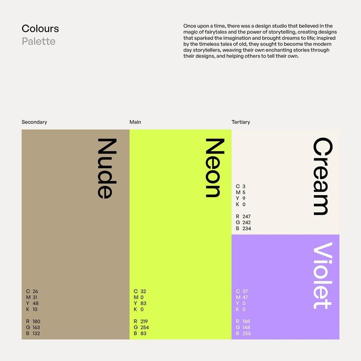

# Nude, Neon, Cream and Violet Colour Blocks

**Discipline:** branding ·  · **Design style:** Geometric & Bauhaus
**Tags:** palette, neon, nude, cream, violet, cmyk, rotated-type, swiss

## What it is
A light grey page titled Colours Palette with a story paragraph and four large colour blocks in a Swiss-style layout: tall nude, neon lime, cream over violet, with the colour name rotated 90 degrees in each block and CMYK and RGB values in small type below.

## What it means
Big flat blocks with rotated names feel confident and editorial, and listing print and screen values shows professional rigour.

## Techniques
- Colour blocks of unequal size as a composition
- Colour names rotated 90 degrees inside each block
- CMYK and RGB values in tiny monospace-like lists
- Main, secondary and tertiary labels above blocks
- Neon lime as the loud anchor against neutral blocks

## Best for
- Brand colour documentation
- Editorial brand presentations
- Print and screen colour specs

## Vocabulary
- **Colour hierarchy** — Ranking palette colours as main, secondary and tertiary.
- **CMYK** — The four-ink colour model used in print.
- **Rotated label** — Text turned 90 degrees inside a block.
