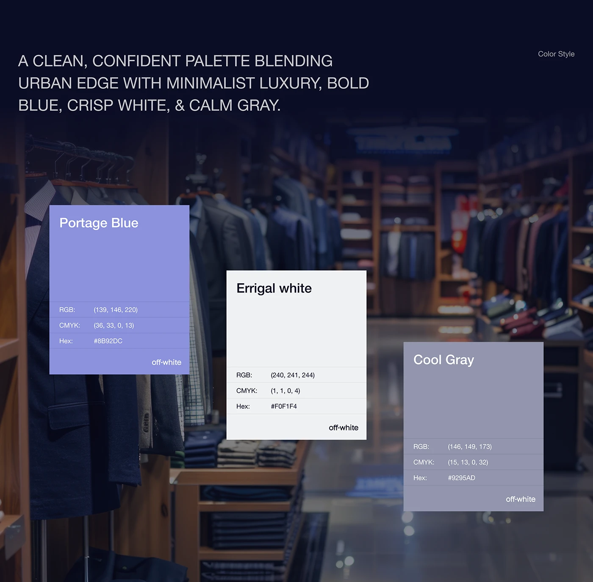

# Three swatch cards (Portage Blue, Errigal white, Cool Gray) with RGB, CMYK and hex over a dark menswear store photo

**Discipline:** branding ·  · **Design style:** Editorial
**Tags:** colour-palette, blue, white, grey, store-photo, navy, uppercase-headline, specs

## What it is
A navy-tinted photo of a menswear store with a light uppercase headline about an urban-edge and minimalist-luxury palette and three staggered swatch cards each with a name, three spec rows (RGB, CMYK, Hex) and the brand name.

## What it means
Refined and grounded; placing swatches over the real store links colour to context.

## Techniques
- Stagger swatch cards over a real-world photo.
- Tint the photo navy.
- List three colour specs on each card.
- Set an uppercase light headline.

## Best for
- Retail brand palette pages
- Palettes shown in context
- Fashion identities

## Vocabulary
- **Swatch card** — A card showing a colour with its specs.
- **Contextual palette** — Swatches placed over a real environment.
- **Stagger** — Cards offset at different heights.
- **Tinted photo** — A photo overlaid with a colour.
