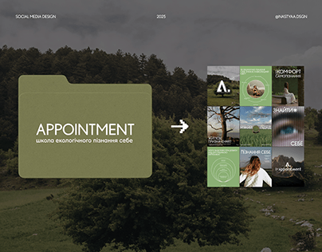

# Olive folder title card pointing to a 3x3 nature feed on a darkened forest field

**Discipline:** branding ·  · **Design style:** Warm & Organic
**Tags:** cover, olive, nature, folder, feed-grid, arrow, forest, social-media

## What it is
A darkened landscape of trees and a grassy field. On the left an olive folder-shaped card carries 'APPOINTMENT' and a Ukrainian subtitle; an arrow points to a 3x3 feed grid of green-toned posts. Tiny header labels sit across the top.

## What it means
Grounded, calm and organic; the folder plus arrow shows brand and result at a glance.

## Techniques
- Turn a folder shape into a title card.
- Point with an arrow to the resulting feed grid.
- Use a darkened natural photo as backdrop.
- Keep the palette to olive, cream and forest green.

## Best for
- Social media identity presentations
- Wellness and eco education brands
- Before-and-after style covers

## Vocabulary
- **Folder card** — A card shaped like a file folder holding a title.
- **Result grid** — A grid of finished posts shown as outcome.
- **Pointer arrow** — An arrow connecting cause and result.
- **Darkened backdrop** — A photo dimmed so foreground shapes pop.
