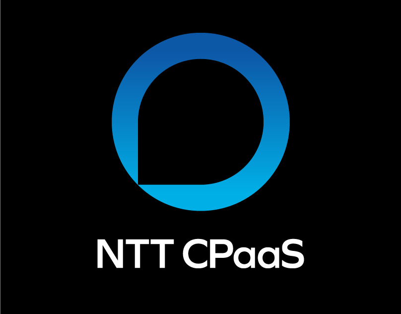

# Gradient blue ring shaped like a speech bubble with white sans wordmark on black

**Discipline:** branding · **Design type:** Logo with symbol
**Tags:** logo, symbol, ring, speech-bubble, blue-gradient, black, telecom, wordmark

## What it is
A black slide with a thick blue ring with one squared bottom-left corner forming a speech bubble, filled with a vertical gradient from deep to bright blue, above a white bold sans wordmark 'NTT CPaaS'.

## What it means
Clear and communicative; the bubble ring is simple and friendly.

## Techniques
- Turn a circle into a speech bubble with one squared corner.
- Fill with a smooth blue gradient.
- Stack a plain white wordmark below.
- Present on black.

## Best for
- Communication and telecom brands
- Simple ring symbols
- Tech identity slides

## Vocabulary
- **Ring symbol** — A logo built from a thick circle.
- **Squared corner** — One corner left sharp to imply a bubble tail.
- **Gradient fill** — A colour blend inside the symbol.
- **Stacked lockup** — Symbol above the name.
