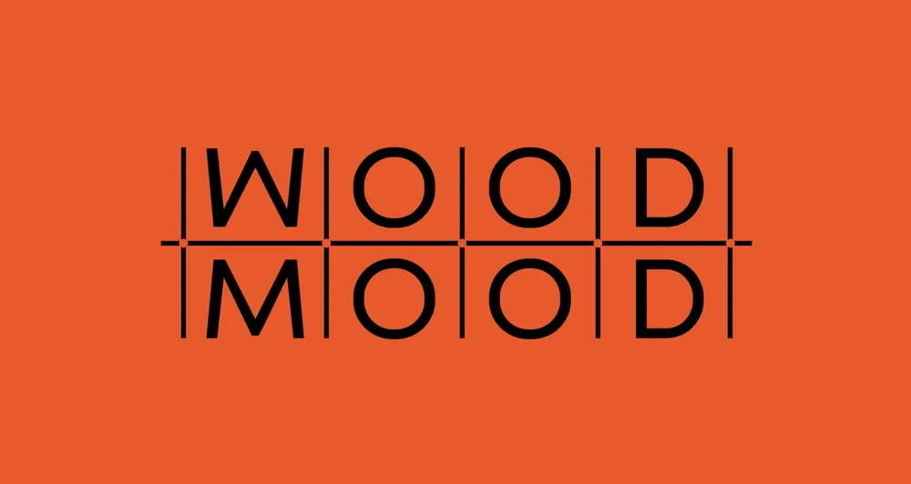

# Gridded Stacked Wordmark on Orange

**Discipline:** branding ·  · **Design style:** Geometric & Bauhaus
**Tags:** wordmark, grid, stacked, orange, black, geometric, mirror

## What it is
A black sans wordmark 'WOOD MOOD' stacked in two rows with each letter in its own cell, separated by thin vertical lines and a horizontal rule with dots at the crossings, on a flat orange field.

## What it means
The rhyme of WOOD/MOOD is made visible: only the first letter changes, and the grid frames it like a lab table or a game board. Orange and black are punchy and craft-like.

## Techniques
- Place each letter in a ruled cell to expose the modular structure
- Stack near-identical words so the single change stands out
- Dot markers at line intersections as detail
- Two-color palette only, flat and high contrast
- Slight tilt on the first letter to create character

## Best for
- Furniture, craft and design studios
- Brands built on wordplay
- Typographic identities and posters

## Vocabulary
- **Cell grid lettering** — Letters set inside boxes formed by ruled lines.
- **Stacked wordmark** — A name split over multiple lines forming a block.
- **Rhyme mark** — A logo built from two words differing by one letter.
