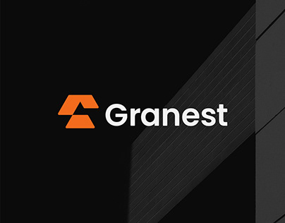

# Orange stacked-arrow symbol beside white 'Granest' wordmark on black with diagonal building texture

**Discipline:** branding ·  · **Design style:** Dark & Neon
**Tags:** logo, symbol, orange, black, real-estate, arrow, facade, wordmark

## What it is
A black cover with a diagonal building facade texture at right, an orange symbol of two stacked angular arrows and a white rounded sans wordmark 'Granest'.

## What it means
Strong and upward; stacked arrows feel like floors and growth.

## Techniques
- Stack angular arrows as floors.
- Use orange on black.
- Add a subtle facade texture.
- Pair with a friendly round sans.

## Best for
- Real-estate and construction brands
- Arrow-based symbols
- Dark cover slides

## Vocabulary
- **Stacked arrows** — Two arrows layered to show growth.
- **Facade texture** — A building surface pattern.
- **Orange on black** — A high-energy colour pairing.
- **Round sans** — A sans with round letterforms.
