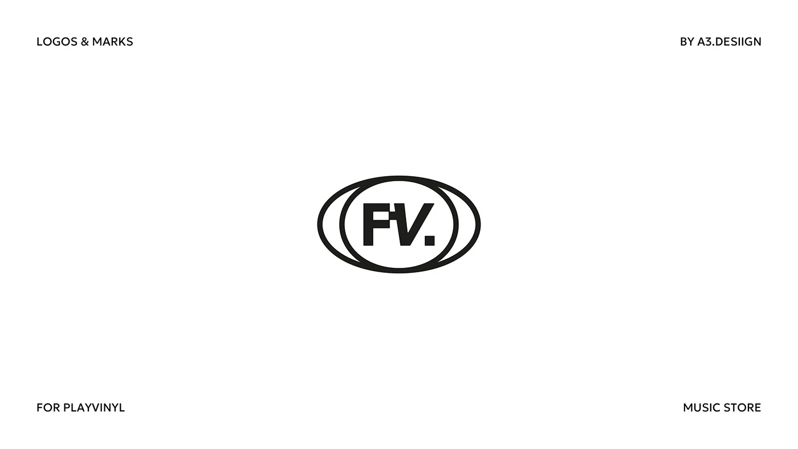

# Black double-oval frame around a chunky F and V monogram with a notched F and full stop

**Discipline:** branding ·  · **Design style:** Minimalist
**Tags:** logo, monogram, oval, black-and-white, music-store, vinyl, corner-labels, minimal

## What it is
A white slide with corner captions and a black symbol of an ellipse and an inner circle framing the letters 'FV.' with a notched F and a slanted V, referencing a record sleeve or lens.

## What it means
Bold and compact; the oval frame suggests a record and gives the monogram a badge feel.

## Techniques
- Frame a monogram in overlapping ovals.
- Notch a letter for character.
- Add a full stop.
- Keep pure black on white.

## Best for
- Music stores and record labels
- Monogram badges
- Minimal logo slides

## Vocabulary
- **Oval frame** — An elliptical outline surrounding a mark.
- **Notched letter** — A letter with a cut for character.
- **Badge monogram** — Initials inside an emblem.
- **Corner captions** — Small labels in the corners.
