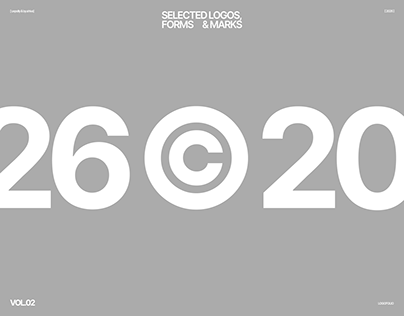

# Grey cover with giant cropped year numerals and a copyright mark

**Discipline:** branding · **Design type:** Logo portfolio cover
**Tags:** logo-portfolio, grey, white-type, giant-numerals, copyright-symbol, minimal, volume-cover

## What it is
A mid-grey slide with tiny caps title 'SELECTED LOGOS, FORMS & MARKS' at the top, and giant white bold numerals '26 © 20' cropped by the edges with a circled-c symbol in the middle. 'VOL.02' sits at the bottom left.

## What it means
Confident and editorial; the copyright glyph doubles as a cover graphic and a joke on ownership.

## Techniques
- Use a giant symbol (©) as the graphic centre of a cover.
- Crop huge numerals off the frame.
- Use a flat grey field to keep white type crisp.
- Frame with tiny caps labels at the corners.

## Best for
- Logo folio and volume covers
- Minimal portfolio covers
- Brand-mark collections

## Vocabulary
- **Copyright glyph** — The circled C used as a graphic.
- **Numeral crop** — Numbers cut by the frame.
- **Volume label** — Text naming an edition of a portfolio.
- **Flat field** — A single-colour background.
