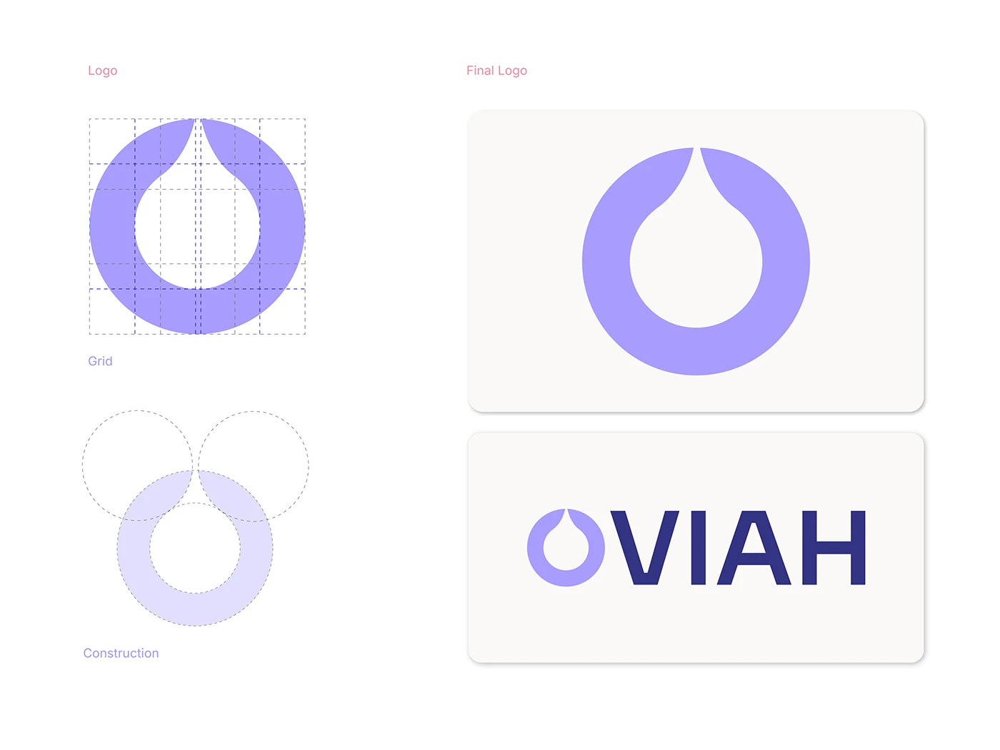

# OVIAH logo construction: grid and circle-overlap diagrams beside the final droplet mark and wordmark lockup

**Discipline:** branding · **Design type:** Logo guidelines · **Design style:** Minimalist
**Tags:** logo-design, construction-grid, droplet, lilac, wordmark

## What it is
A page showing the logo's underlying geometry — a dashed grid and three overlapping construction circles that form a droplet ring — beside two 'Final Logo' cards: the lilac droplet-ring mark alone, and the full 'OVIAH' lockup with the mark replacing the O.

## What it means
Rigorous and intentional; showing the geometric construction proves the mark wasn't drawn freehand.

## Techniques
- Reveal the grid and circles behind a finished logo.
- Show the mark both standalone and inside the wordmark.
- Let the mark double as the first letter of the name.

## Best for
- Logo design case studies
- Brand guideline documents
- Identity construction proof

## Vocabulary
- **Construction grid** — The geometric guides used to draw a logo precisely.
- **Lockup** — A logo and wordmark combined into one fixed unit.
