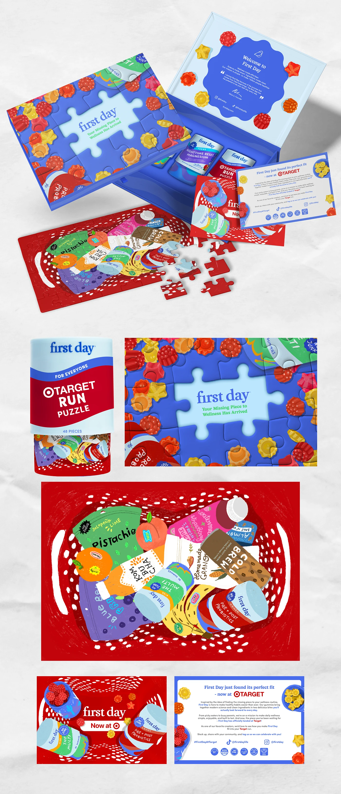

# Retail-launch puzzle kit: blue gift box, gummy-covered puzzle, red basket illustration and welcome letter

**Discipline:** branding ·  · **Design style:** Playful & Illustrated
**Tags:** packaging, puzzle, royal-blue, red, illustration, gummies, gift-box, launch-kit

## What it is
A tall board showing a royal blue box opened to reveal tubs, a welcome card with a wavy blue seal, a puzzle whose picture is a hand-painted red shopping basket full of brand products, a canister labelled 'Run Puzzle 48 pieces', a puzzle close-up with gummies, a red 'Now at' card and a printed letter.

## What it means
Joyful and clever; a puzzle turns 'the missing piece' message into a physical gift.

## Techniques
- Make the message ('missing piece') a puzzle.
- Illustrate a basket of products in painterly gouache.
- Match box, canister and letter to a blue-red palette.
- Use gummies as pattern.

## Best for
- Retail launch PR kits
- Packaging concepts with a gimmick
- Illustrated gift boxes

## Vocabulary
- **PR kit** — A box of items sent to promote a launch.
- **Gouache illustration** — Painterly flat-colour hand illustration.
- **Wavy seal** — A wave-edged shape holding a message.
- **Puzzle packaging** — Packaging built around a puzzle.
