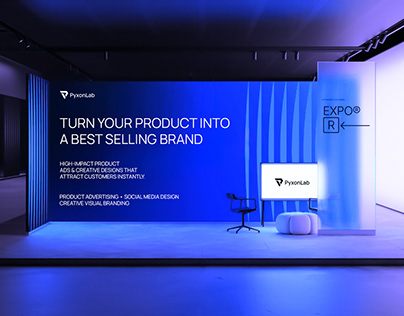

# PyxonLab expo booth mockup: electric blue wall with 'Turn your product into a best selling brand'

**Discipline:** branding · **Design type:** Brand application mockups · **Design style:** Gradient & Aurora
**Tags:** expo, booth, blue, environmental, agency, mockup

## What it is
A dark exhibition hall with a long booth wall glowing electric blue with ribbed fabric panels, a white headline and service list, the PyxonLab logo on a small screen, a chair and pouf, and a frosted 'EXPO R' sign panel.

## What it means
Bold and immersive; one saturated colour fills the space and becomes the brand.

## Techniques
- Flood an environment in a single brand colour.
- Use ribbed panels to catch light and add texture.
- Keep copy short and uppercase at wall scale.

## Best for
- Trade show booths
- Agency brand decks
- Environmental graphics

## Vocabulary
- **Environmental graphics** — Branding applied to physical spaces.
- **Booth** — A branded stand at an exhibition.
