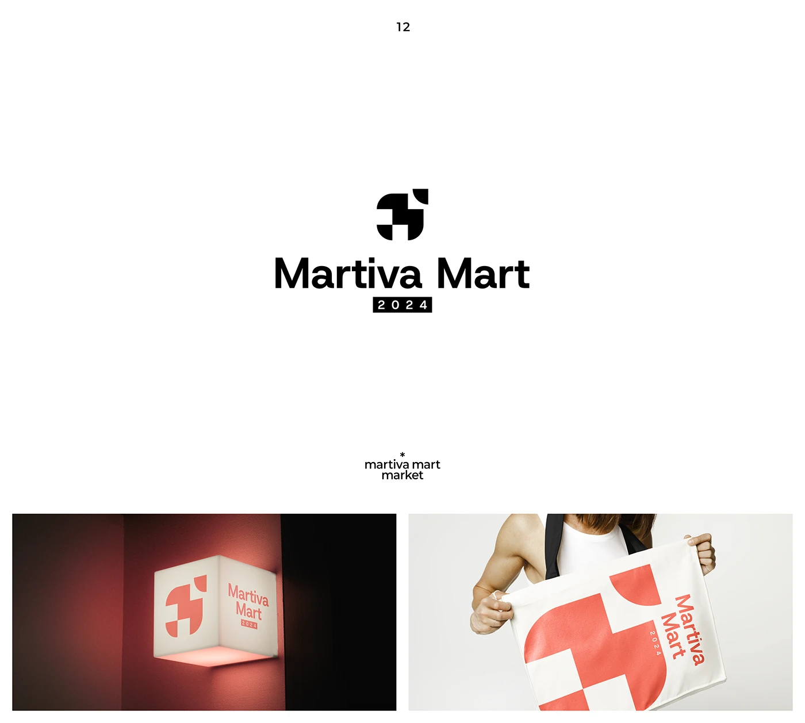

# Chequered-block market logo with lit cube sign and coral tote

**Discipline:** branding · **Design type:** Logo with symbol
**Tags:** logo, symbol, geometric, mosaic, market, coral, light-box, tote

## What it is
A white slide with a black symbol built from quarter circles and squares, a bold sans wordmark 'Martiva Mart' and a black '2024' tab. Two applications: a glowing cube sign on a red wall showing the mark in coral on cream, and a person holding a white tote with an enlarged coral mosaic and vertical name.

## What it means
Bold, systematic and friendly; modular shapes suggest stalls in a market.

## Techniques
- Build a symbol from a grid of quarter-circle and square modules.
- Enlarge and crop the symbol as a pattern on bags.
- Use a limited coral on cream for applications.
- Attach a small year tab to the wordmark.

## Best for
- Retail, markets and marketplaces
- Modular identities
- Signage and tote-driven brands

## Vocabulary
- **Modular symbol** — A mark built from repeatable geometric units.
- **Quarter-circle module** — A square with one rounded corner used as a shape unit.
- **Light-box sign** — An illuminated cube or panel with a logo.
- **Year tab** — A small block containing a date beside a logo.
