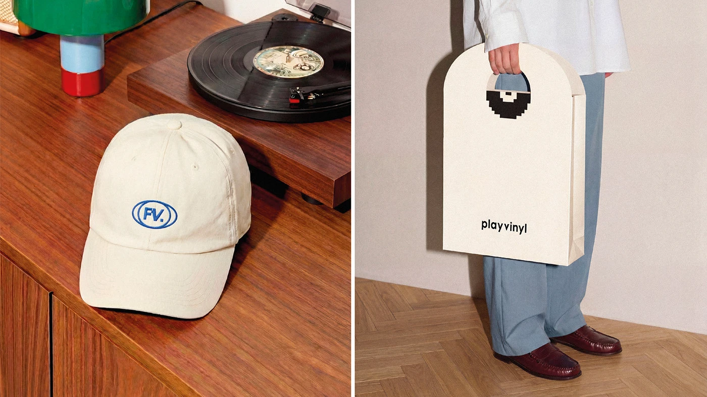

# Record store identity on an embroidered cap and arched bag with pixel vinyl handle

**Discipline:** branding · **Design type:** Merch and packaging
**Tags:** retail, music, vinyl, cap, tote, pixel-icon, cream, blue-embroidery, lifestyle-photography

## What it is
A split photo: left, a cream cap with a blue oval 'FV.' embroidery on a wood cabinet beside a turntable; right, a person holding a tall arched cream paper bag whose cut-out handle reveals a pixelated black vinyl record and the word 'playvinyl'.

## What it means
Warm, retro and witty; the die-cut handle turns the bag into a record-sleeve object.

## Techniques
- Integrate the handle cut-out with the logo shape (record).
- Embroider a monogram in one accent blue on cream.
- Use an arched top silhouette for the bag.
- Shoot merchandise in a matching interior with wood and warm tones.

## Best for
- Music retail and lifestyle brands
- Packaging with a clever structure
- Merch presentations

## Vocabulary
- **Die-cut handle** — A handle formed by cutting a shape through the pack.
- **Pixel icon** — A pictogram built from square pixels.
- **Embroidered mark** — A logo stitched onto fabric.
- **Arched silhouette** — A shape with a rounded top.
