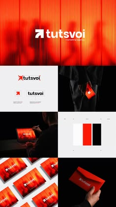

# Red-orange identity board with arrow mark on fluted glass

**Discipline:** branding · **Design type:** Brand identity presentation
**Tags:** identity, red, orange, arrow-logo, fluted-glass, business-cards, envelope, black-and-white

## What it is
A vertical identity board: a fluted-glass blurred red-orange hero with a white arrow logo and lowercase wordmark; a white logo lockup panel; a hand pulling a red card from a black pocket; a laptop; stacked red business cards; a colour palette of white, red and black; and a hand holding a red envelope.

## What it means
Bold, kinetic and confident; the upward arrow suggests growth and the fiery colour feels premium.

## Techniques
- Use reeded or fluted glass imagery as a moving-colour backdrop.
- Pair a simple arrow symbol with a lowercase wordmark.
- Limit the palette to red, black and white.
- Show the brand on small physical items (cards, envelope) in dramatic lighting.

## Best for
- Marketing and creative agencies
- Startups wanting bold identity
- Identity presentations

## Vocabulary
- **Fluted glass** — Textured glass with vertical ridges that blurs and distorts colour.
- **Arrow mark** — A logo built from an arrow, suggesting direction.
- **Three-colour palette** — A brand palette of only three colours.
- **Stationery flat lay** — Cards and envelopes arranged and photographed together.
