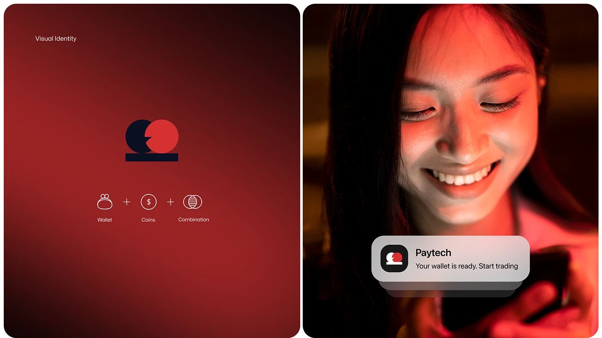

# Red Logo Concept with Portrait Notification

**Discipline:** branding ·  · **Design style:** Photographic & Cinematic
**Tags:** logo, red, wallet, coins, concept, notification, portrait

## What it is
A two-part board: a red vignette panel with a navy and red circle-and-bar mark and a wallet plus coins plus combination formula, and a red-lit portrait of a smiling woman with a frosted notification card showing the app icon.

## What it means
Showing the idea equation behind the mark gives it meaning, and the portrait shows the brand in an everyday moment.

## Techniques
- Idea formula (wallet plus coins equals mark) beneath the logo
- Two-circle mark in navy and red on a bar
- Red-lit photography to match the brand
- Frosted notification card with app icon
- Two equal rounded panels side by side

## Best for
- Fintech logo presentations
- Explaining logo concepts
- Brand plus photography boards

## Vocabulary
- **Concept formula** — A plus-sign diagram showing which ideas combine into a logo.
- **Notification card** — A frosted card imitating a push notification.
- **Two-panel board** — A presentation split into a logo panel and a photo panel.
