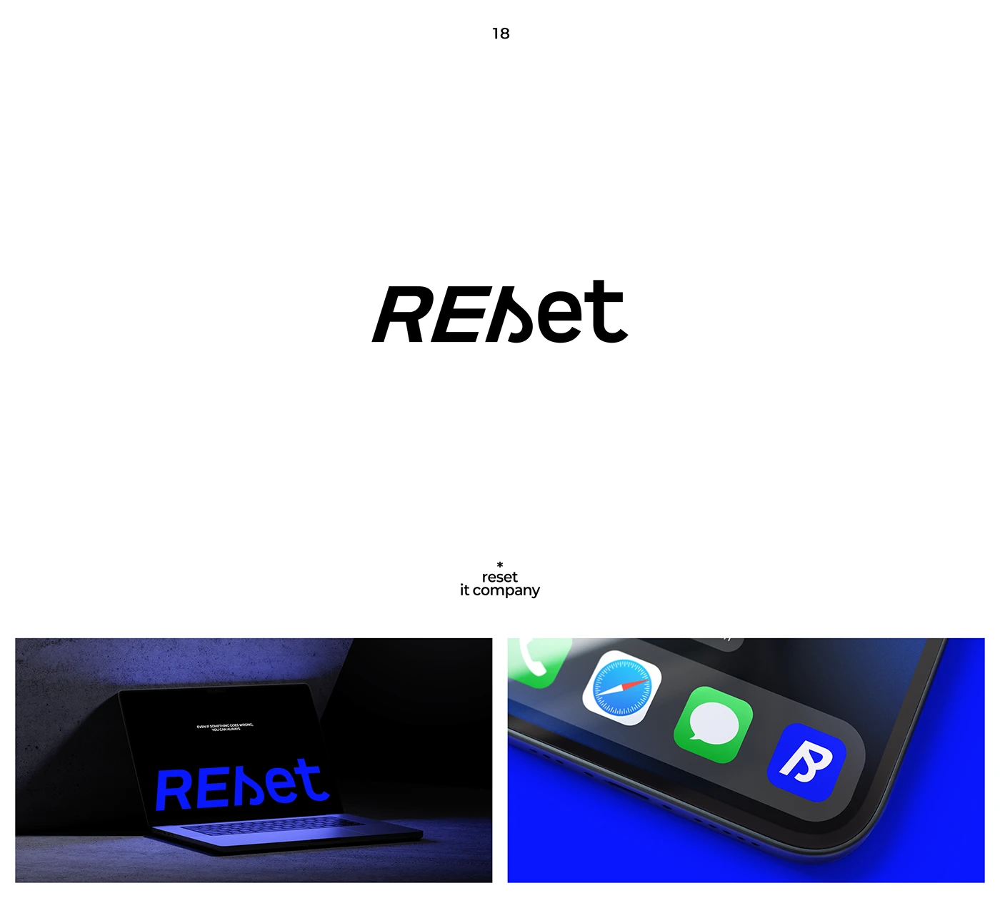

# Bold italic RESET wordmark with a flipped s, shown in electric blue on a dark laptop and phone dock

**Discipline:** branding · **Design type:** Wordmarks
**Tags:** wordmark, italic, electric-blue, black-and-white, laptop, app-icon, typographic-twist, it-company

## What it is
A white slide with a heavy italic black 'REset' where the s is mirrored, a tiny caption 'reset it company', and two photos: a blue wordmark glowing on a dark laptop against concrete, and a blue app icon with a stylised R among iOS icons on a blue background.

## What it means
Clever and kinetic; the flipped letter makes 'reset' visible.

## Techniques
- Flip one letter to illustrate the name's meaning.
- Use heavy italic for momentum.
- Show electric blue on dark and on a phone dock.
- Reduce the mark to a single-letter app icon.

## Best for
- Tech and IT brands
- Wordmarks with a concept twist
- App icon derivations

## Vocabulary
- **Mirrored letter** — A letter flipped horizontally as a concept device.
- **Italic momentum** — Slanted type suggesting speed.
- **Electric blue** — A vivid saturated blue.
- **Icon derivation** — A simplified app icon based on the logo.
